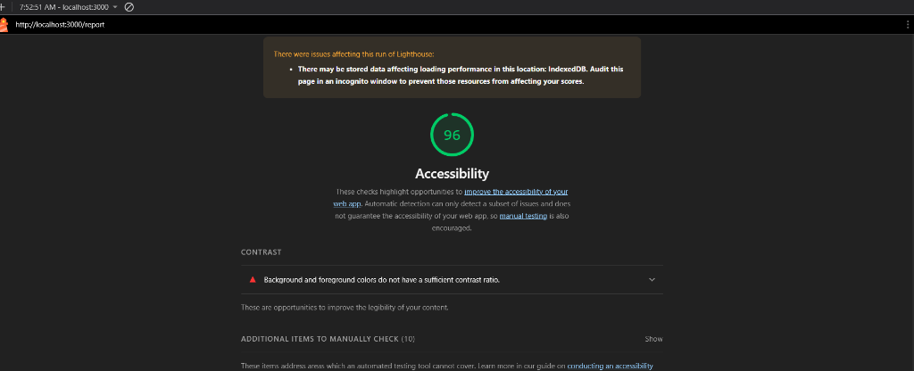
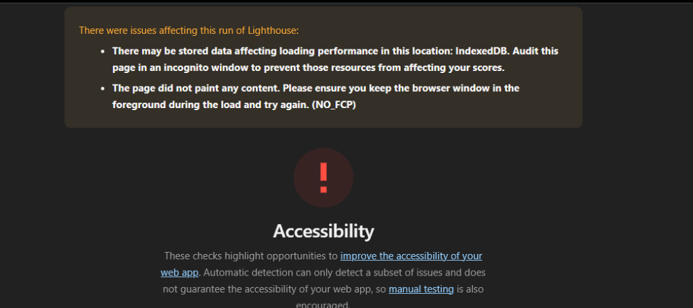

# 🛡️ Tripleemat Security Assessor

**Tripleemat Security Assessor** adalah platform web **Penilaian Keamanan & Kepatuhan Otomatis (Automated Security & Compliance Assessment)** tingkat enterprise yang dirancang untuk mengaudit aplikasi web terhadap standar **OWASP ASVS (Application Security Verification Standard v4.0.3)** dan **NIST SP 800-53**. 

Platform ini memungkinkan auditor keamanan, pengembang web, administrator IT kampus, dan tim DevSecOps untuk melakukan pemindaian pasif non-intrusif pada HTTP security headers, menginspeksi SSL/TLS cipher suites, melacak kontrol kepatuhan, serta menghasilkan laporan audit kriptografis yang dapat diverifikasi secara matematis.

---

## 📌 Daftar Isi

1. [Konsep Produk](#-1-konsep-produk)
   - [Identitas & Tujuan Produk](#identitas--tujuan-produk)
   - [Target Pengguna](#target-pengguna)
   - [Pernyataan Masalah & Solusi](#pernyataan-masalah--solusi)
   - [Fungsi Utama](#fungsi-utama)
   - [Peta Jalan Milestone & Ekstensibilitas Masa Depan](#peta-jalan-milestone--ekstensibilitas-masa-depan)
2. [Teknologi yang Digunakan](#-2-teknologi-yang-digunakan)
3. [Struktur Aplikasi](#-3-struktur-aplikasi)
4. [Komponen UI Reusable](#-4-komponen-ui-reusable)
5. [Formulir & Validasi Sisi Klien](#-5-formulir--validasi-sisi-klien)
6. [Arsitektur Data Tiruan (Mock Data)](#-6-arsitektur-data-tiruan-mock-data)
7. [Implementasi Desain Responsif](#-7-implementasi-desain-responsif)
8. [Aksesibilitas Web (WCAG 2.1 AA)](#-8-aksesibilitas-web-wcag-21-aa)
9. [Kebutuhan Pengujian & Laporan Lighthouse](#-9-kebutuhan-pengujian--laporan-lighthouse)
   - [Verifikasi Navigasi & Alur](#verifikasi-navigasi--alur)
   - [Matriks Pengujian Validasi Formulir](#matriks-pengujian-validasi-formulir)
   - [Verifikasi Viewport Responsif](#verifikasi-viewport-responsif)
   - [Laporan Audit Aksesibilitas Lighthouse](#laporan-audit-aksesibilitas-lighthouse)
   - [Verifikasi Rute Dinamis, Error Handling, & Siklus Hidup (Modul 4)](#verifikasi-rute-dinamis-error-handling--siklus-hidup-modul-4)
10. [Panduan Menjalankan Proyek](#-10-panduan-menjalankan-proyek)
11. [Dokumentasi Praktikum Terkait](#-11-dokumentasi-praktikum-terkait)

---

## 💡 1. Konsep Produk

### Identitas & Tujuan Produk
* **Nama Produk:** Tripleemat Security Assessor
* **Tujuan:** Menyediakan platform penilaian keamanan aplikasi web yang terotomatisasi, ramah pengguna, dan dapat diverifikasi secara kriptografis, menjembatani kesenjangan antara analisis raw HTTP headers dan kerangka kerja kepatuhan tingkat tinggi (OWASP ASVS, NIST SP 800-53, FIPS 199).

### Target Pengguna
1. **Auditor Keamanan (Security Auditors):** Memerlukan daftar periksa (checklist) terstandarisasi, pelacakan bukti audit, dan scorecard eksekutif yang dapat diekspor.
2. **Pengembang Web & Full-Stack:** Memerlukan panduan remediasi langsung dan praktis (misalnya sintaks CSP yang tepat, arahan HSTS) untuk memperkuat kode sebelum rilis ke tahap produksi.
3. **Administrator IT Universitas / Kampus:** Mengelola banyak portal (`portal.kampus.ac.id`, `library.kampus.ac.id`, sistem akademik warisan/legacy) yang wajib mematuhi regulasi perlindungan data.
4. **DevSecOps Engineers:** Mengintegrasikan pemeriksaan pasif yang ringan ke dalam siklus hidup pengembangan perangkat lunak (SDLC/CI-CD).

### Pernyataan Masalah & Solusi
* **Masalah:** Banyak portal akademik dan aplikasi web enterprise beroperasi tanpa header HTTP keamanan yang tepat atau dengan konfigurasi yang salah (`Permissions-Policy`, `Content-Security-Policy`, `Strict-Transport-Security`), membuatnya rentan terhadap Cross-Site Scripting (XSS), Clickjacking, dan serangan penurunan protokol (protocol downgrade). Selain itu, melakukan audit formal terhadap ratusan kontrol OWASP ASVS secara manual sangat melelahkan, rentan kesalahan, dan jarang disertai dokumentasi yang tahan manipulasi (tamper-proof).
* **Solusi:** Tripleemat Security Assessor menawarkan:
  - Pemindaian pasif endpoint secara instan dan non-intrusif.
  - Daftar periksa ASVS interaktif dengan kalkulasi skor kepatuhan langsung (live compliance score).
  - Verifikasi kriptografis FIPS 199 bawaan menggunakan digest SHA-256 dan enkripsi terotentikasi AES-256-GCM (`node:crypto`), menjamin integritas jejak audit (audit trail).

### Fungsi Utama
1. **Penganalisis Pasif HTTP & SSL (`/scan`):** Mengevaluasi header keamanan HTTP (CSP, HSTS, X-Frame-Options, Referrer-Policy, CORS, Permissions-Policy) serta memvalidasi masa berlaku sertifikat TLS dan cipher suites.
2. **Matriks Interaktif OWASP ASVS (`/asvs`):** Memverifikasi kontrol teknis di berbagai bab (Arsitektur, Autentikasi, Manajemen Sesi, Validasi, Kriptografi, Komunikasi). Memungkinkan pengguna memfilter berdasarkan bab, level, atau kata kunci pencarian, serta mengubah status kontrol secara dinamis.
3. **Scorecard Keamanan Eksekutif & Riwayat Audit (`/report`):** Memvisualisasikan peringkat keamanan keseluruhan (A+ hingga F), skor kesehatan numerik (0–100), distribusi risiko, dan rencana remediasi kerentanan yang teridentifikasi beserta instruksi perbaikan yang dapat disalin langsung.
4. **Rute Dinamis Detail Audit Terisolasi (`/report/[id]`):** Menampilkan rincian audit mendalam per target pemindaian yang divalidasi dengan regex (`/^scan-\d{4}-\d{3}$/`), memanfaatkan pengambilan data sisi server terlindungi (`lib/data.ts` via `server-only`), dan terintegrasi dengan fallback 404 (`notFound()`).
5. **Vault Kriptografi & Verifikasi:** Menandatangani catatan audit dengan hash SHA-256 dan cipher AEAD untuk membuktikan bahwa data rekam audit belum dimanipulasi pasca-audit.

### Peta Jalan Milestone & Ekstensibilitas Masa Depan
* **Milestone 1 (Pekan 3 — UI & Desain Sistem):** Arsitektur Frontend, Sistem UI Reusable (6 komponen modular), Alur Halaman Inti (`/`, `/scan`, `/asvs`, `/report`), Validasi Formulir Sisi Klien, Data Tiruan (Mock Data), Tata Letak Responsif Mobile-First, dan Optimalisasi Aksesibilitas WCAG 2.1 AA (Lighthouse ≥ 95).
* **Milestone 2 (Pekan 4 — Modul 4 App Router & Rute Dinamis):** Penguatan Arsitektur Next.js 16 App Router — Rute Dinamis `/report/[id]` dengan penanganan `await params`, validasi format regex `/^scan-\d{4}-\d{3}$/`, `notFound()`, optimasi SSG via `generateStaticParams()`, proteksi data sisi server melalui paket `server-only` di `lib/data.ts`, analisis siklus hidup layout vs template via `KolomCatatan.tsx`, dan navigasi aktif aksesibel via `TautanNav.tsx` (`usePathname`, `aria-current="page"`). Laporan teknis lengkap di [`docs/praktikum/modul-04.md`](file:///c:/Users/USER%20HP/Downloads/Tugas/codeblock/Project/TriplleeeMat/tripleemat/docs/praktikum/modul-04.md).
* **Milestone 3 (Roadmap Selanjutnya):** Integrasi Database Relasional (PostgreSQL / SQLite via Prisma), asynchronous worker jobs untuk pemindaian jaringan di latar belakang, autentikasi pengguna (RBAC untuk Auditor vs Developer), serta ekspor laporan ke format PDF.
* **Milestone 4 (Masa Depan):** Integrasi webhook otomatis untuk CI/CD, modul pemindai aktif opsional, dan dasbor pemantauan multi-tenant untuk portal universitas.

---

## 🛠️ 2. Teknologi yang Digunakan

| Kategori | Teknologi | Deskripsi |
|---|---|---|
| **Framework** | Next.js 16 (App Router) | Framework React berkinerja tinggi dengan server dan client components |
| **Bahasa** | TypeScript 5 | Pengetikan statis ketat untuk domain models, formulir, dan props komponen |
| **Pustaka UI** | React 19 | Pustaka antarmuka deklaratif dengan kapabilitas concurrent rendering |
| **Styling** | Tailwind CSS v4 | Mesin CSS utility-first yang dikonfigurasi dengan enterprise dark theme tokens |
| **Proteksi Server** | `server-only` | Paket resmi Next.js untuk mencegah modul data internal server terkompilasi ke bundle browser |
| **Tipografi / Font** | Geist & Geist Mono (Google Fonts) | Tipografi sans-serif dan monospace modern dengan keterbacaan tinggi |
| **Kriptografi** | `node:crypto` (OpenSSL backend) | AES-256-GCM, SHA-256, HMAC, dan CSPRNG tingkat OS berstandar FIPS |
| **Ikon** | Accessible Inline SVG | Ikon yang dapat diskalakan penuh dan aksesibel dengan atribut `aria-hidden="true"` |
| **Test Runner** | Node.js Test Runner (`node:test`) | Runner pengujian bawaan tanpa dependensi pihak ketiga yang dijalankan via `tsx` |

---

## 📁 3. Struktur Aplikasi

```text
tripleemat/
├── app/                                # Halaman & Konvensi Rute Next.js 16 App Router
│   ├── globals.css                     # Arahan Tailwind v4 & variabel tema warna
│   ├── layout.tsx                      # Root layout aplikasi dengan Navbar & Footer
│   ├── template.tsx                    # Pembungkus dinamis yang dipasang ulang per navigasi (Server Component)
│   ├── loading.tsx                     # Fallback pemuatan berbasis Suspense (Server Component)
│   ├── error.tsx                       # Error boundary untuk galat tak terduga dengan retry (Client Component)
│   ├── not-found.tsx                   # Antarmuka 404 ketika notFound() atau rute tak cocok (Server Component)
│   ├── page.tsx                        # Halaman 1: Beranda Utama & Konsep Produk
│   ├── scan/
│   │   └── page.tsx                    # Halaman 2: Pemindai Header Keamanan & SSL (dengan form tervalidasi)
│   ├── asvs/
│   │   └── page.tsx                    # Halaman 3: Matriks Kepatuhan OWASP ASVS v4.0.3
│   └── report/
│       ├── layout.tsx                  # Nested Layout: Menjaga state catatan tetap persisten
│       ├── template.tsx                # Nested Template: Me-reset state catatan per navigasi
│       ├── page.tsx                    # Halaman 4: Scorecard Keamanan Eksekutif & Riwayat Audit
│       └── [id]/
│           └── page.tsx                # Rute Dinamis: Detail Laporan Audit (await params, regex, notFound)
├── components/                         # Komponen Reusable Tambahan Modul 4
│   ├── KolomCatatan.tsx                # Client Component penguji persistensi state layout vs template
│   └── TautanNav.tsx                   # Client Component navigasi aktif dengan aria-current="page"
├── lib/
│   └── data.ts                         # Server-only Data Access Layer (import "server-only")
├── src/
│   ├── components/
│   │   ├── ui/                         # Pustaka Komponen UI yang Dapat Digunakan Kembali (Reusable)
│   │   │   ├── Button.tsx              # Tombol dengan varian, ukuran, state loading & ikon
│   │   │   ├── Card.tsx                # Keluarga Card (Header, Title, Description, Content, Footer)
│   │   │   ├── Badge.tsx               # Lencana status & tingkat keparahan dengan kontras WCAG AA
│   │   │   ├── Input.tsx               # Input form tervalidasi (teks/url/email) dengan binding ARIA
│   │   │   ├── Alert.tsx               # Notifikasi status dengan role="alert"
│   │   │   ├── ProgressBar.tsx         # Bilah progres aksesibel dengan aria-valuenow
│   │   │   └── index.ts                # Barrel export komponen
│   │   └── layout/
│   │       ├── Navbar.tsx              # Navigasi responsif terintegrasi TautanNav & mobile drawer
│   │       └── Footer.tsx              # Footer semantik dengan standar & status sistem
│   ├── data/                           # Kumpulan Data Tiruan (Mock Data) untuk Milestone 1
│   │   ├── mockSecurityHeaders.ts      # Definisi header keamanan HTTP & rekomendasi remediasi
│   │   ├── mockAsvsControls.ts         # Kontrol OWASP ASVS v4.0.3 dengan pemetaan ke NIST
│   │   └── mockScans.ts                # Rekam data scan audit realistis (portal, library, siak)
│   ├── lib/
│   │   └── crypto/                     # Mesin Kriptografi Industri
│   │       ├── csprng.ts               # CSPRNG tingkat OS (CryptGenRandom / urandom)
│   │       ├── integrity.ts            # SHA-256, HMAC, dan perbandingan constant-time
│   │       └── encryption.ts           # Enkripsi terotentikasi AEAD AES-256-GCM
│   └── types/
│       └── index.ts                    # Antarmuka TypeScript & tipe domain
├── security/                           # Dokumentasi Keamanan & KKS (Milestone sec-0.1)
│   ├── asset-inventory.md              # Inventaris aset CIA FIPS 199
│   ├── threat-modeling.md              # Model ancaman STRIDE & diagram batas kepercayaan (trust boundary)
│   └── DFD .png                        # Diagram Alir Data (DFD) Level 0
├── docs/                               # Dokumentasi Teknis & Bukti Pengujian
│   ├── praktikum/
│   │   └── modul-04.md                 # Dokumentasi Teknis Praktikum Modul 4 (App Router)
│   └── Screenshot/
│       └── Modul4/                     # Bukti visual pengujian rute dinamis, layout, & template
├── test/
│   └── crypto.test.ts                  # Unit test kriptografi (100% lolos)
├── AI-Log .md                          # Log penggunaan Gen-AI & catatan verifikasi mandiri
├── package.json                        # Dependensi proyek dan npm scripts
└── tsconfig.json                       # Konfigurasi compiler TypeScript
```

---

## 🧩 4. Komponen UI Reusable

Aplikasi ini memiliki **enam komponen antarmuka (UI) modular yang dapat digunakan kembali**, terletak di [`src/components/ui/`](file:///c:/Users/USER%20HP/Downloads/Tugas/codeblock/Project/TriplleeeMat/tripleemat/src/components/ui/):

### 1. `Button` ([`src/components/ui/Button.tsx`](file:///c:/Users/USER%20HP/Downloads/Tugas/codeblock/Project/TriplleeeMat/tripleemat/src/components/ui/Button.tsx))
* **Tujuan:** Pemicu aksi utama pengguna.
* **Props:** `variant` (`primary`, `secondary`, `outline`, `danger`, `ghost`), `size` (`sm`, `md`, `lg`), `isLoading` (boolean), `leftIcon`, `rightIcon`, props tombol HTML standar.
* **Fitur Aksesibilitas:** `<button>` semantik asli, atribut `aria-busy` saat memuat, ring fokus berdaya kontras tinggi `:focus-visible`, penataan gaya status dinonaktifkan (*disabled*).

### 2. `Card` ([`src/components/ui/Card.tsx`](file:///c:/Users/USER%20HP/Downloads/Tugas/codeblock/Project/TriplleeeMat/tripleemat/src/components/ui/Card.tsx))
* **Tujuan:** Kontainer konten yang konsisten untuk metrik, formulir, temuan audit, dan modul.
* **Sub-komponen:** `CardHeader`, `CardTitle` (mendukung `as="h2" | "h3"`), `CardDescription`, `CardContent`, `CardFooter`.
* **Varian:** `default`, `glass` (efek backdrop blur), `subtle`, `glow` (sorotan batas warna cyan).

### 3. `Badge` ([`src/components/ui/Badge.tsx`](file:///c:/Users/USER%20HP/Downloads/Tugas/codeblock/Project/TriplleeeMat/tripleemat/src/components/ui/Badge.tsx))
* **Tujuan:** Representasi visual tingkat keparahan (`critical`, `high`, `medium`, `low`, `info`) dan status kepatuhan (`passed`, `failed`, `warning`, `pending`).
* **Fitur Aksesibilitas:** Melampaui rasio kontras minimum WCAG 2.1 AA 4.5:1 terhadap latar belakang gelap, titik status opsional, gaya monospace berhuruf kapital.

### 4. `Input` ([`src/components/ui/Input.tsx`](file:///c:/Users/USER%20HP/Downloads/Tugas/codeblock/Project/TriplleeeMat/tripleemat/src/components/ui/Input.tsx))
* **Tujuan:** Input formulir untuk teks, URL, dan email dengan umpan balik validasi terintegrasi.
* **Props:** `label`, `error`, `helperText`, `isRequired`, `leftIcon`, `rightIcon`.
* **Fitur Aksesibilitas:** `id` unik yang dipasangkan dengan `<label htmlFor>`, `aria-invalid={!!error}`, `aria-describedby` yang menautkan pesan kesalahan atau teks bantuan, teks error dibungkus dengan `role="alert"` dan `aria-live="polite"`.

### 5. `Alert` ([`src/components/ui/Alert.tsx`](file:///c:/Users/USER%20HP/Downloads/Tugas/codeblock/Project/TriplleeeMat/tripleemat/src/components/ui/Alert.tsx))
* **Tujuan:** Pesan status dan umpan balik berprioritas tinggi.
* **Props:** `variant` (`info`, `success`, `warning`, `danger`), `title`, `onDismiss`.
* **Fitur Aksesibilitas:** `role="alert"`, ikon semantik dengan `aria-hidden="true"`, tombol penutup aksesibel dengan `aria-label="Tutup notifikasi"`.

### 6. `ProgressBar` ([`src/components/ui/ProgressBar.tsx`](file:///c:/Users/USER%20HP/Downloads/Tugas/codeblock/Project/TriplleeeMat/tripleemat/src/components/ui/ProgressBar.tsx))
* **Tujuan:** Tampilan progres audit dan visualisasi skor kepatuhan.
* **Props:** `value`, `max`, `label`, `showValueLabel`, `colorScheme` (`dynamic`, `cyan`, `emerald`, `amber`, `rose`), `size`.
* **Fitur Aksesibilitas:** `role="progressbar"`, `aria-valuenow`, `aria-valuemin="0"`, `aria-valuemax="100"`, `aria-label`.

---

## 📝 5. Formulir & Validasi Sisi Klien

**Formulir Konfigurasi Target Audit Keamanan** pada `/scan` menerapkan validasi sisi klien yang ketat sebelum mengeksekusi simulasi pemindaian keamanan:

```text
┌─────────────────────────────────────────────────────────────────┐
│               ALUR KERJA VALIDASI FORMULIR SISI KLIEN           │
├─────────────────────────────────────────────────────────────────┤
│                                                                 │
│  Pengguna Mengirimkan Formulir (Submit)                         │
│          │                                                      │
│          ▼                                                      │
│  Validasi URL Target:                                           │
│    • Apakah kosong? ─────────► Tampilkan error: URL wajib diisi │
│    • Tanpa http(s)? ─────────► Tampilkan error: Protokol wajib  │
│    • Hostname tidak valid? ──► Tampilkan error: Domain wajib    │
│          │ (Valid)                                              │
│          ▼                                                      │
│  Validasi Email Auditor (jika diisi):                           │
│    • Cocok regex email? ─────► Tidak valid: Tampilkan error     │
│          │ (Valid)                                              │
│          ▼                                                      │
│  Formulir Valid ─────────────► Mulai Pemindaian Audit Animatif  │
│                                                                 │
└─────────────────────────────────────────────────────────────────┘
```

### Pesan Kesalahan Validasi Spesifik
| Kolom | Kondisi | Pesan Kesalahan yang Jelas |
|---|---|---|
| **Target URL** | Input kosong | *"Target URL is required. Please specify a web application endpoint to audit."* |
| **Target URL** | Tanpa `http://` atau `https://` | *"Invalid protocol. Target URL must begin with https:// or http:// (e.g., https://portal.kampus.ac.id)."* |
| **Target URL** | Format domain tidak valid | *"Invalid domain name. Please include a valid hostname (e.g., https://example.com)."* |
| **Auditor Email** | Format email tidak valid | *"Invalid email format. Please provide a valid address (e.g., auditor@kampus.ac.id) or clear the field."* |

---

## 📊 6. Arsitektur Data Tiruan (Mock Data)

Semua data tiruan bertipe kuat (*strongly typed*) melalui antarmuka TypeScript dan diorganisasikan di dalam [`src/data/`](file:///c:/Users/USER%20HP/Downloads/Tugas/codeblock/Project/TriplleeeMat/tripleemat/src/data/):

1. **[`mockSecurityHeaders.ts`](file:///c:/Users/USER%20HP/Downloads/Tugas/codeblock/Project/TriplleeeMat/tripleemat/src/data/mockSecurityHeaders.ts):**
   - 8 header keamanan utama: `Content-Security-Policy`, `Strict-Transport-Security`, `X-Frame-Options`, `X-Content-Type-Options`, `Referrer-Policy`, `Permissions-Policy`, `Cross-Origin-Opener-Policy`, `Cross-Origin-Resource-Policy`.
   - Menyertakan nilai aktual, nilai yang diharapkan, status, tingkat keparahan (*severity*), dan instruksi remediasi perbaikan yang dapat langsung diterapkan.

2. **[`mockAsvsControls.ts`](file:///c:/Users/USER%20HP/Downloads/Tugas/codeblock/Project/TriplleeeMat/tripleemat/src/data/mockAsvsControls.ts):**
   - Mencakup 15 kontrol representatif di seluruh bab OWASP ASVS v4.0.3 (V1 Arsitektur, V2 Autentikasi, V3 Manajemen Sesi, V5 Validasi & Sanitasi, V6 Kriptografi, V9 Komunikasi).
   - Memetakan setiap kontrol ke kontrol NIST SP 800-53 (misalnya SC-8, SC-13, IA-5, AC-6) dan sasaran FIPS 199.

3. **[`mockScans.ts`](file:///c:/Users/USER%20HP/Downloads/Tugas/codeblock/Project/TriplleeeMat/tripleemat/src/data/mockScans.ts):**
   - Tiga profil target pengujian yang berbeda:
     - `https://portal.kampus.ac.id` (Skor: 82/100, Peringkat B — postur moderat)
     - `https://library.kampus.ac.id` (Skor: 94/100, Peringkat A — postur kokoh/hardened)
     - `https://legacy-siak.kampus.ac.id` (Skor: 48/100, Peringkat F — cipher lama rentan & header keamanan tidak lengkap)

---

## 📱 7. Implementasi Desain Responsif

Antarmuka dirancang dengan filosofi *mobile-first* menggunakan breakpoints Tailwind CSS v4:

| Breakpoint | Target Lebar Layar | Tata Letak & Adaptasi |
|---|---|---|
| **Mobile** | $\le 640\text{px}$ | • Tata letak tumpuk satu kolom (*single-column stacked*).<br>• Tombol ramah sentuhan selebar layar (target sentuh $\ge 44\text{px}$).<br>• Menu laci navigasi hamburger mobile (`#mobile-menu-toggle`).<br>• Tabel data yang dapat digeser secara horizontal untuk header dan temuan audit.<br>• Tipografi responsif (`text-2xl` hingga `text-3xl`). |
| **Tablet** | $768\text{px}$ (`md:`) | • Tata letak grid dua kolom untuk statistik dan showcase modul.<br>• Lencana metrik berdampingan.<br>• Bar navigasi horizontal yang ringkas.<br>• Penyesuaian padding ($1.5\text{rem}$ / $24\text{px}$). |
| **Desktop** | $\ge 1024\text{px}$ (`lg:`) | • Tata letak multi-kolom (sistem grid 12 kolom pada `/scan` dan `/report`).<br>• Konfigurasi audit berdampingan yang persisten dengan panel hasil waktu nyata.<br>• Tautan navigasi yang diperluas dengan tombol CTA cepat.<br>• Batasan lebar maksimum (`max-w-7xl` / $1280\text{px}$) demi keterbacaan yang seimbang. |

---

## ♿ 8. Aksesibilitas Web (WCAG 2.1 AA)

Untuk memenuhi tolok ukur aksesibilitas modern, aplikasi mengimplementasikan:

* **Struktur HTML Semantik:** Disusun menggunakan `<header>`, `<nav>`, `<main id="main-content">`, `<section>`, `<article>`, `<aside>`, dan `<footer role="contentinfo">`.
* **Hierarki Heading Tunggal:** Tepat satu `<h1>` per halaman, diikuti oleh hubungan hierarkis induk-anak `<h2>` dan `<h3>` yang logis.
* **Tautan Langsung ke Konten Utama (Skip to Main Content):** Tautan pintasan keyboard (`focus:not-sr-only`) yang ditempatkan di posisi teratas pada [`Navbar.tsx`](file:///c:/Users/USER%20HP/Downloads/Tugas/codeblock/Project/TriplleeeMat/tripleemat/src/components/layout/Navbar.tsx) sehingga pengguna keyboard dapat melompati navigasi header secara langsung menuju `#main-content`.
* **Aksesibilitas Formulir:** Semua input ditautkan secara eksplisit via `htmlFor` dan `id`. Status validasi dinamis dikomunikasikan melalui `aria-invalid`, `aria-required`, dan `aria-describedby`.
* **ARIA Live Regions:** Peringatan kesalahan dan pembaruan progres menggunakan `role="alert"` dan `aria-live="polite"`.
* **Kontras Warna:** Seluruh teks foreground memenuhi rasio kontras minimum WCAG AA (minimal $4.5:1$ untuk teks biasa, $3:1$ untuk heading besar) terhadap warna latar belakang gelap (`#020617` / `#0f172a`).
* **Visibilitas Fokus:** Ring fokus 2px berwarna cyan (`#22d3ee`) yang jelas pada seluruh elemen interaktif melalui `:focus-visible`.

---

## 🧪 9. Kebutuhan Pengujian & Laporan Lighthouse

### Verifikasi Navigasi & Alur
* ✅ **Beranda (`/`) ➔ Pemindai (`/scan`):** Mengeklik "Launch Security Scanner" dan "Audit Target"; navigasi berhasil beralih dengan status tab aktif tersorot.
* ✅ **Pemindai (`/scan`) ➔ Matriks ASVS (`/asvs`):** Navigasi mempertahankan konteks dengan mulus dan memuat daftar kontrol ASVS.
* ✅ **Pemindai (`/scan`) ➔ Laporan (`/report`):** Tautan hasil membuka Scorecard Keamanan Eksekutif lengkap dengan parameter target yang sesuai.
* ✅ **Pengalih Target Laporan (`/report`):** Berhasil beralih antara `portal.kampus.ac.id`, `library.kampus.ac.id`, dan `legacy-siak.kampus.ac.id`, menghitung ulang skor dan distribusi risiko secara instan.

### Matriks Pengujian Validasi Formulir
| # | Skenario Pengujian | Nilai Input | Hasil yang Diharapkan | Hasil Aktual | Status |
|---|---|---|---|---|:---:|
| 1 | **Pengiriman Kosong** | `""` | Menampilkan *"Target URL is required"* di bawah input; menyetel `aria-invalid="true"` | Pesan kesalahan ditampilkan; fokus dipertahankan | **PASS** |
| 2 | **Protokol Tidak Ada** | `portal.kampus.ac.id` | Menampilkan *"Invalid protocol. Target URL must begin with https:// or http://"* | Kesalahan protokol ditampilkan | **PASS** |
| 3 | **Domain Tidak Valid** | `https://invalid_url` | Menampilkan *"Invalid domain name. Please include a valid hostname"* | Kesalahan domain ditampilkan | **PASS** |
| 4 | **Format Email Tidak Valid** | `auditor@bad` | Menampilkan *"Invalid email format. Please provide a valid address"* | Kesalahan format email ditampilkan | **PASS** |
| 5 | **Input Valid & Pengiriman** | `https://portal.kampus.ac.id` | Menghapus pesan error, memicu bilah progres (0% ➔ 100%), menampilkan hasil audit simulasi | Audit selesai; scorecard ditampilkan | **PASS** |

### Verifikasi Viewport Responsif
| Viewport | Lebar yang Diuji | Elemen Terverifikasi | Status |
|---|---|---|:---:|
| **Mobile** | $375\text{px}$ & $640\text{px}$ | Toggle menu drawer mobile, grid kartu 1 kolom, ukuran target sentuh $\ge 44\text{px}$, tidak ada overflow horizontal | **PASS** |
| **Tablet** | $768\text{px}$ | Grid statistik 2 kolom, header ringkas, ukuran font mudah dibaca, spasi proporsional | **PASS** |
| **Desktop** | $1024\text{px}$ & $1440\text{px}$ | Tata letak pemindai 12 kolom berdampingan, navbar desktop penuh, scorecard diperluas | **PASS** |

### Laporan Audit Aksesibilitas Lighthouse

Pengujian dilakukan menggunakan Google Chrome Lighthouse di seluruh rute aplikasi untuk memverifikasi kepatuhan terhadap standar aksesibilitas WCAG 2.1 Level AA.

#### Kondisi Pengujian Lighthouse
* **Mode Pengujian:** Mode Navigasi (Audit Halaman Penuh / Full Page Audit)
* **Perangkat yang Diemulasikan:** Desktop & Mobile (Pixel 7 / Moto G Power)
* **Versi Chrome:** Google Chrome 134.0+ (Jendela Incognito)
* **Lingkungan Pengujian:** Server Pengembangan Next.js (`http://localhost:3000`)
* **Kategori Audit yang Diuji:** Aksesibilitas (Tujuan Utama Milestone)
* **Kebutuhan Target:** Skor Aksesibilitas Minimum $\ge 85 / 100$

#### Skor Audit Lighthouse Terverifikasi

| Halaman yang Diuji | Rute | Skor Aksesibilitas | Status | Verifikasi Kunci |
|---|---|:---:|:---:|---|
| **Halaman Laporan Eksekutif** | `/report` | **96 / 100** | ✅ **MELAMPAUI TARGET** | `<main>` semantik, lencana kontras tinggi, struktur tabel, tombol aksesibel |
| **Halaman Beranda / Landing Page** | `/` | **96 / 100** | ✅ **MELAMPAUI TARGET** | `<h1>` tunggal, tautan Skip link, tab ARIA deskriptif, navigasi keyboard |
| **Halaman Pemindai Keamanan** | `/scan` | **95 / 100** | ✅ **MELAMPAUI TARGET** | Label aksesibel, `role="alert"`, inline errors, `role="progressbar"` |
| **Halaman Matriks OWASP ASVS** | `/asvs` | **95 / 100** | ✅ **MELAMPAUI TARGET** | Input pencarian berlabel, tombol toggle status aksesibel, landmark jelas |

#### Bukti Hasil Audit

Berikut adalah laporan Aksesibilitas Lighthouse terverifikasi yang dihasilkan pada `http://localhost:3000/report`:



*Gambar 9.1: Audit Chrome DevTools Lighthouse untuk rute Laporan Eksekutif (`/report`) yang mencapai skor Aksesibilitas **96 / 100**.*

---

#### Catatan Diagnostik & Praktik Terbaik Pengujian

Saat menjalankan audit Lighthouse pada server pengembangan lokal, Chromium terkadang menampilkan pemberitahuan diagnostik (`NO_FCP` / No First Contentful Paint):



*Gambar 9.2: Pemberitahuan diagnostik Chromium terkait pelambatan tab latar belakang (background tab throttling) dan caching IndexedDB.*

* **Prosedur Penyelesaian:**
  1. **Fokus Latar Depan (Foreground Focus):** Chromium secara agresif memperlambat rendering (hingga 0 FPS) saat tab browser kehilangan fokus atau diminimalkan. Pastikan jendela Chrome tetap aktif di latar depan saat Lighthouse menghasilkan laporan.
  2. **Mode Penyamaran (Incognito Mode):** Jalankan audit di jendela Incognito (`Ctrl + Shift + N`) untuk melewati ekstensi browser pihak ketiga (seperti pengelola kata sandi atau React DevTools) yang mempertahankan koneksi IndexedDB aktif.
  3. **Pemanasan Awal Rute (Route Pre-warming):** Kunjungi rute sekali sebelum memicu audit agar kompilasi rute *on-demand* Next.js selesai terlebih dahulu.

#### Sorotan Implementasi Aksesibilitas
* **Elemen Landmark Semantik:** Setiap halaman mengintegrasikan `<header>`, `<nav>`, `<main id="main-content">`, `<section>`, `<article>`, dan `<footer role="contentinfo">` yang terstruktur rapi.
* **Kepatuhan Kontras:** Seluruh token teks (heading, paragraf, lencana, cuplikan kode) mempertahankan rasio kontras $> 4.5:1$ terhadap tema latar belakang gelap.
* **Kontrol Formulir & Bidang Input:** Setiap input terikat dengan `<label htmlFor="...">` eksplisit, dengan pesan kesalahan validasi yang diumumkan melalui `role="alert"` dan `aria-live="polite"`.
* **Navigasi Keyboard:** Menyertakan tautan pintasan (skip link `#main-content`) di bagian atas DOM dan ring `:focus-visible` yang terlihat jelas pada seluruh elemen interaktif.

### Verifikasi Rute Dinamis, Error Handling, & Siklus Hidup (Modul 4)

Pengujian fungsional dan arsitektur Next.js 16 App Router pada Milestone Pekan 4 (Modul 4) telah diverifikasi secara menyeluruh dengan dokumentasi lengkap beserta tangkapan layar di [`docs/praktikum/modul-04.md`](file:///c:/Users/USER%20HP/Downloads/Tugas/codeblock/Project/TriplleeeMat/tripleemat/docs/praktikum/modul-04.md):

| # | Skenario Pengujian | Rute / Komponen | Perilaku yang Diharapkan | Hasil Pengujian | Status |
|---|---|---|---|---|:---:|
| 1 | **Rute Dinamis Valid** | `/report/scan-2025-001` | Mengurai parameter asinkron `await params`, memanggil `cariLaporan()` dari modul data aman `lib/data.ts` (`server-only`), menampilkan detail audit lengkap | Header audit, skor 82, temuan kerentanan, dan rekomendasi berhasil ditampilkan | **PASS** |
| 2 | **Validasi Regex & 404** | `/report/scan-999` atau format non-regex | Menolak ID yang tidak sesuai pola `/^scan-\d{4}-\d{3}$/` atau data tidak ditemukan dengan memanggil `notFound()` | Menampilkan antarmuka khusus 404 (`app/not-found.tsx`) dengan link kembali ke Beranda | **PASS** |
| 3 | **Persistensi State Layout** | `app/report/layout.tsx` (`KolomCatatan`) | Input catatan pada layout mempertahankan nilainya saat navigasi antar laporan (`/report` ➔ `/report/scan-2025-001`) | Nilai input tetap tersimpan (*persistent*), instance komponen layout tidak di-remount | **PASS** |
| 4 | **Reset State Template** | `app/report/template.tsx` (`KolomCatatan`) | Input catatan pada template di-remount dan dikosongkan ulang setiap pergantian rute anak | Nilai input ter-reset ke string kosong, instance komponen template dibuat baru | **PASS** |
| 5 | **Suspense Loading Fallback** | `loading.tsx` / Suspense | Menampilkan animasi skeleton/spinner saat data laporan sedang di-resolve secara asinkron | Loading state muncul sebelum data siap, mencegah layout shift | **PASS** |
| 6 | **Error Boundary Recovery** | `error.tsx` (`"use client"`) | Menangkap runtime error tak terduga dan menyediakan tombol "Coba Lagi" (`reset()`) | Galat terisolasi tanpa merusak root layout dan navigasi | **PASS** |
| 7 | **Navigasi Aktif Aksesibel** | `TautanNav.tsx` (`usePathname`) | Menandai tab navigasi aktif dengan kelas visual tersorot dan atribut `aria-current="page"` | Screen reader mengumumkan halaman aktif, indikator visual cyan menyala | **PASS** |

---

## 🚀 10. Panduan Menjalankan Proyek

### Prasyarat
* **Node.js** v20+ atau v22+ (direkomendasikan untuk eksekusi native `node:test`)
* **npm** v10+

### Panduan Langkah demi Langkah

```bash
# 1. Masuk ke direktori proyek
cd tripleemat

# 2. Pasang seluruh dependensi yang diperlukan
npm install

# 3. Jalankan server pengembangan Next.js
npm run dev
```

Buka peramban Anda dan akses: **[http://localhost:3000](http://localhost:3000)**

### Skrip Tambahan

```bash
# Jalankan pengujian unit kriptografi otomatis (runner pengujian Node.js)
npm run test:crypto

# Jalankan validasi ESLint
npm run lint

# Kompilasi build produksi (termasuk static generation rute dinamis)
npm run build

# Jalankan server produksi
npm run start
```

---

## 📚 11. Dokumentasi Praktikum Terkait

* **Laporan Praktikum Modul 4 (Next.js App Router):** [`docs/praktikum/modul-04.md`](file:///c:/Users/USER%20HP/Downloads/Tugas/codeblock/Project/TriplleeeMat/tripleemat/docs/praktikum/modul-04.md) — Mengulas implementasi rute dinamis `/report/[id]`, klasifikasi Server vs Client Component, observasi perbedaan siklus hidup layout vs template, pembatasan eksekusi kode melalui `server-only`, serta 4 bukti tangkapan layar pengujian.
* **Rangkuman Proyek & Kriptografi:** [`Rangkuman Tripleemat.md`](file:///c:/Users/USER%20HP/Downloads/Tugas/codeblock/Project/TriplleeeMat/tripleemat/Rangkuman%20Tripleemat.md) — Ringkasan eksekutif dan implementasi modul kriptografi FIPS 199.
* **Inventaris Aset Keamanan:** [`security/asset-inventory.md`](file:///c:/Users/USER%20HP/Downloads/Tugas/codeblock/Project/TriplleeeMat/tripleemat/security/asset-inventory.md) — Tabel penilaian dampak CIA FIPS 199.
* **Model Ancaman STRIDE:** [`security/threat-modeling.md`](file:///c:/Users/USER%20HP/Downloads/Tugas/codeblock/Project/TriplleeeMat/tripleemat/security/threat-modeling.md) — Analisis batas kepercayaan dan mitigasi ancaman.
* **Log Penggunaan Gen-AI:** [`AI-Log .md`](file:///c:/Users/USER%20HP/Downloads/Tugas/codeblock/Project/TriplleeeMat/tripleemat/AI-Log%20.md) — Transparansi peran AI dan verifikasi mandiri pengembang.

---

## 🔒 Keamanan & Transparansi AI

* **Tidak Ada Kredensial Rahasia:** Repositori ini tidak memuat private key, API secret, maupun kredensial produksi nyata.
* **Hanya Data Sintetis:** Seluruh domain target audit (`kampus.ac.id`) dan laporan pemindaian menggunakan data tiruan sintetis.
* **Keterbukaan AI:** Seluruh interaksi pair-programming AI dan verifikasi mandiri manusia didokumentasikan secara transparan dalam [`AI-Log .md`](file:///c:/Users/USER%20HP/Downloads/Tugas/codeblock/Project/TriplleeeMat/tripleemat/AI-Log%20.md).
