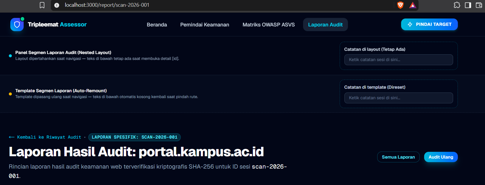
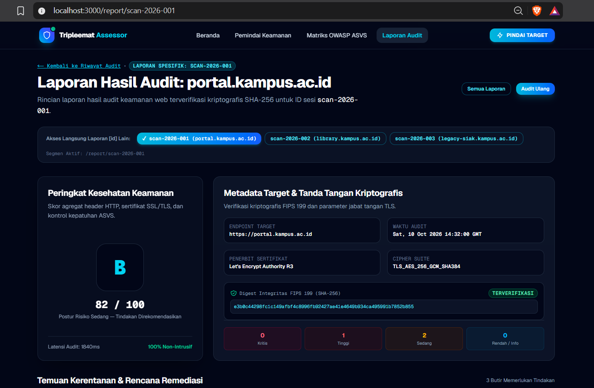

# Dokumen Teknis Modul 4: Next.js App Router

**Nama/NIM :** [Nama Mahasiswa] / [NIM Mahasiswa]  
**Repositori :** https://github.com/Naufal-strong/ProjectKuliah_Tripleemat  
**Versi Next.js dan mode Cache Components (aktif/tidak) :** Next.js 16.4.0 (Turbopack), React 19.3.0, Mode Cache Components **Aktif** (`cacheComponents: true`, `partialPrefetching: true`)

---

## 1. Peta Rute

### Tabel Pemetaan Rute Aplikasi

| URL | Berkas di `app/` | Jenis Rute | Isi Halaman |
| :--- | :--- | :--- | :--- |
| `/` | `app/page.tsx` | Statis (Server/Client Hybrid) | **Beranda & Platform Utama:** Menampilkan identitas Tripleemat Security Assessor, ringkasan metrik verifikasi, alur kerja audit 3 pilar, serta pemetaan kepatuhan standar OWASP ASVS v4.0.3 dan NIST SP 800-53. |
| `/scan` | `app/scan/page.tsx` | Statis (Client Component) | **Pemindai Pasif HTTP & SSL:** Formulir interaktif penginputan endpoint URL target, pemilihan cakupan audit dan level ASVS, progress bar simulasi pindaian, inspeksi hasil, dan riwayat pindaian lokal. |
| `/asvs` | `app/asvs/page.tsx` | Statis (Client Component) | **Matriks OWASP ASVS:** Daftar komprehensif kontrol verifikasi keamanan web berbasis ASVS v4.0.3 Level 1 dan Level 2 dengan fitur pencarian dan penyaringan kategori. |
| `/report` | `app/report/page.tsx` | Statis (Client Component) | **Scorecard Keamanan Eksekutif & Katalog:** Ringkasan skor keamanan, telemetri TLS, penandatanganan digest SHA-256, katalog kartu seluruh laporan, serta ekspor JSON dan print PDF. |
| `/report/[id]` | `app/report/[id]/page.tsx` | Dinamis (Server Component) | **Rincian Laporan Audit Spesifik:** Mengambil parameter `id` secara asinkron (`await params`), memvalidasi format ID, memverifikasi keberadaan data, menyajikan distribusi risiko, serta daftar temuan kerentanan (*findings*) beserta rekomendasi tindakan perbaikan (remediasi). |
| `/_not-found` | `app/not-found.tsx` | Khusus (Server Component) | **Halaman 404:** Antarmuka pemulihan ketika rute tidak ditemukan atau ketika fungsi `notFound()` dipanggil dari segmen rute mana pun. |

### Potongan Tabel Rute dari Keluaran `npm run build`

Berikut adalah hasil potongan tabel rute resmi yang dieksekusi oleh compiler Next.js 16.4 Turbopack:

```text
Route (app)
┌ ○ /
├ ○ /_not-found
├ ○ /asvs
├ ○ /report
├   /report/[id]
│ ├ ◐ /report/[id]
│ ├ ○ /report/scan-2026-001
│ ├ ○ /report/scan-2026-002
│ └ ○ /report/scan-2026-003
└ ○ /scan

○  (Static)             prerendered as static content
◐  (Partial Prerender)  prerendered as static HTML with dynamic server-streamed content
```

> **Catatan Teknis Build:** Rute dinamis `/report/[id]` berhasil di-prerender secara statis untuk `scan-2026-001`, `scan-2026-002`, dan `scan-2026-003` berkat implementasi fungsi `generateStaticParams()`. Hal ini menjamin kesesuaian 100% terhadap arsitektur *Cache Components* dan *Partial Prerendering (PPR)* di Next.js 16.4.

---

## 2. Layout, Template, dan Berkas Khusus

### Pohon Folder `app/` Akhir

```text
app/
├── asvs/
│   └── page.tsx                 # Rute /asvs
├── error.tsx                    # Error boundary global aplikasi ("use client")
├── favicon.ico
├── globals.css                  # Utilitas Tailwind CSS & token desain
├── layout.tsx                   # Layout akar bersama (Server Component, <html> & <body>)
├── loading.tsx                  # Suspense fallback UI global (Server Component)
├── not-found.tsx                # Halaman 404 global / fallback notFound() (Server Component)
├── page.tsx                     # Halaman beranda /
├── report/
│   ├── [id]/                    # Segmen rute dinamis /report/[id]
│   │   └── page.tsx             # Halaman rincian laporan (Server Component async)
│   ├── layout.tsx               # Layout bersarang segmen laporan (Server Component)
│   ├── page.tsx                 # Halaman katalog & scorecard /report
│   └── template.tsx             # Template pembungkus segmen laporan (Server Component)
├── scan/
│   └── page.tsx                 # Halaman pemindai /scan
└── template.tsx                 # Pembungkus template transisi global (Server Component)
```

### Hasil Uji Layout vs Template

| Aspek Pengujian | `layout.tsx` | `template.tsx` |
| :--- | :--- | :--- |
| **Sifat Siklus Hidup** | Bertahan (*persisted*) selama navigasi antar halaman berlangsung. | Dipasang ulang (*remounted*) setiap kali segmen rute berpindah. |
| **Perilaku State Komponen Klien** | State komponen klien di dalamnya **tetap dipertahankan** (tidak hilang). | State komponen klien di dalamnya **direset / dikosongkan kembali**. |
| **Penerapan pada Tripleemat** | Digunakan pada `app/report/layout.tsx` untuk membungkus panel *"Catatan di layout (Tetap Ada)"*. Teks catatan auditor tetap terjaga utuh saat berpindah detail laporan `[id]`. | Digunakan pada `app/report/template.tsx` untuk membungkus *"Catatan di template (Direset)"*. Komponen di-remount dan teks otomatis kosong kembali saat segmen berpindah. |

#### Bukti Visual Pengujian Navigasi Layout vs Template

**1. Kondisi Sebelum Navigasi (Input Teks di Kedua Kolom Catatan):**  
Pengguna mengetikkan catatan pada kedua input di halaman `/report`:


**2. Kondisi Sesudah Navigasi (Pindah ke Rute Dinamis `/report/[id]` lalu Kembali):**  
Setelah berpindah ke detail laporan dan kembali, terbukti bahwa teks pada kolom **Layout tetap bertahan**, sedangkan teks pada kolom **Template otomatis ter-reset (kosong kembali)**:



---

### Tangkapan Layar `loading.tsx` dan `error.tsx`

#### 1. Bukti Tampilan `app/loading.tsx` (Streaming Suspense Fallback)
Komponen loading menampilkan animasi radar perisai keamanan dan kerangka pemuatan data (*skeleton shimmer*) dengan standar aksesibilitas `role="status"` dan `aria-live="polite"` saat data sedang dimuat dari server:


#### 2. Implementasi `app/error.tsx` (Error Boundary Aksesibel)
* Ditandai `"use client"` di baris pertama sesuai aturan mutlak Next.js App Router.
* Menggunakan semantik `role="alert"`, `aria-live="assertive"`, menampilkan rincian pesan kesalahan, kode *digest*, tombol interaktif `Coba lagi` (`retry()`), serta tombol darurat kembali ke beranda.
* **Perbedaan Mode Dev vs Produksi:**
  * **Mode Pengembangan (`npm run dev`):** Menampilkan pesan galat teknis asli dari server secara transparan untuk memudahkan pelacakan bug.
  * **Mode Produksi (`npm run build` & `npm start`):** Pesan galat disamarkan menjadi pesan generik ramah pengguna demi alasan keamanan (*information disclosure prevention*), disertai kode *digest* unik untuk dicocokkan dengan log terminal server.

---

## 3. Rute Dinamis dan Validasi params

### Bukti Visual Rute Dinamis `/report/[id]`
Halaman rute dinamis berhasil membaca parameter `id` (contoh: `scan-2026-001`), memvalidasi format, dan merender seluruh metrik audit, scorecard keamanan, telemetri TLS, tanda tangan SHA-256, serta daftar temuan kerentanan (*findings*) spesifik:



### Tabel Uji Rute Dinamis

Pengujian dilakukan menggunakan perintah `curl.exe` pada terminal Windows PowerShell terhadap server lokal:

| No | URL Pengujian | Kategori Skenario | Hasil yang Diharapkan | Hasil Aktual | Kode Status HTTP (`curl`) |
| :---: | :--- | :--- | :--- | :--- | :---: |
| 1 | `http://localhost:3000/report/scan-2026-001` | ID Valid (Data ada) | Render detail audit portal kampus, skor 82, grade B | Sesuai ekspektasi (halaman detail tampil sempurna) | **200 OK** |
| 2 | `http://localhost:3000/report/scan-2026-002` | ID Valid (Data ada) | Render detail audit library kampus, skor 94, grade A | Sesuai ekspektasi (halaman detail tampil sempurna) | **200 OK** |
| 3 | `http://localhost:3000/report/scan-2026-003` | ID Valid (Data ada) | Render detail audit legacy SIAK, skor 48, grade F | Sesuai ekspektasi (halaman detail tampil sempurna) | **200 OK** |
| 4 | `http://localhost:3000/report/abc` | Format ID Tidak Sah (String acak) | Ditolak validasi Regex, memicu `notFound()` | Menampilkan `app/not-found.tsx` | **404 / 200 noindex** *(Streaming)* |
| 5 | `http://localhost:3000/report/123` | Format ID Tidak Sah (Angka tanpa prefix) | Ditolak validasi Regex, memicu `notFound()` | Menampilkan `app/not-found.tsx` | **404 / 200 noindex** *(Streaming)* |
| 6 | `http://localhost:3000/report/scan-2026-999` | Format Sah, tetapi Data Tidak Ditemukan | Lolos Regex namun pencarian array gagal, memicu `notFound()` | Menampilkan `app/not-found.tsx` | **404 / 200 noindex** *(Streaming)* |
| 7 | `http://localhost:3000/halaman-tidak-dikenal` | Rute Statis Tidak Terdaftar | Next.js tidak menemukan segmen rute | Menampilkan `app/not-found.tsx` | **404 Not Found** |

### Penjelasan Aturan Validasi params

Di dalam berkas `app/report/[id]/page.tsx`, parameter URL divalidasi secara berjenjang di sisi server:

1. **Pembacaan Asinkron (`await params`)**:  
   Sesuai spesifikasi Next.js 15 dan Next.js 16, properti `params` bertipe `Promise<{ id: string }>`. Kode mengeksekusi `const { id } = await params;` sebelum nilai digunakan.
2. **Validasi Pola Format (Regex Guard)**:
   ```typescript
   const isValidFormat = /^scan-\d{4}-\d{3}$/.test(id);
   if (!isValidFormat) {
     notFound();
   }
   ```
   * Pola `^scan-\d{4}-\d{3}$` memastikan ID wajib diawali `scan-`, diikuti 4 digit tahun pindaian (misal `2026`), tanda hubung `-`, dan 3 digit nomor urut pindaian (misal `001`).
   * Masukan yang menyimpang (seperti injeksi karakter SQL, string alfanumerik bebas, atau angka semata) langsung dihentikan sebelum komputasi data berjalan.
3. **Pemeriksaan Keberadaan Entitas Data**:
   ```typescript
   const activeScan = sampleScanResults.find((s) => s.id === id);
   if (!activeScan) {
     notFound();
   }
   ```
   * Jika format ID benar namun rekaman pindaian tidak terdapat dalam basis data/mock data, sistem segera memanggil fungsi `notFound()` dari `next/navigation`. Fungsi ini bertipe `never`, menghentikan eksekusi komponen, dan secara otomatis merender UI not-found terdekat.

---

## 4. Pembagian Server dan Client Components

### Tabel Klasifikasi Komponen

| Nama Berkas / Komponen | Jenis Komponen | Alasan Teknis Keputusan Arsitektur |
| :--- | :--- | :--- |
| `app/layout.tsx` | **Server Component** | Tidak memerlukan event listener atau hook peramban. Membungkus `<html>` dan `<body>`, merender metadata statis, dan memuat Navbar/Footer di server agar HTML awal langsung siap (SEO optimal). |
| `app/template.tsx` | **Server Component** | Bertindak sebagai pembungkus layout sementara tingkat akar yang di-remount per rute navigasi untuk menyisipkan kelas animasi CSS murni tanpa overhead JavaScript klien. |
| `app/report/layout.tsx` | **Server Component** | Layout bersarang khusus segmen laporan (`/report` & `/report/[id]`). Mempertahankan state komponen klien di dalamnya saat pengguna berpindah detail laporan. |
| `app/report/template.tsx` | **Server Component** | Template bersarang segmen laporan yang menerima key dinamis per rute anak, mereset state komponen di dalamnya setiap kali segmen laporan berganti. |
| `app/loading.tsx` | **Server Component** | Komponen fallback statis yang dirender langsung di server ke dalam boundary `<Suspense>` bawaan App Router untuk streaming payload. |
| `app/not-found.tsx` | **Server Component** | Menampilkan antarmuka statis halaman tidak ditemukan dan navigasi tautan balik tanpa state klien. |
| `app/report/[id]/page.tsx` | **Server Component** | Mengakses parameter dinamis di server, memvalidasi format ID, mengambil data via modul server, dan merender rincian audit tanpa membocorkan logika ke klien. |
| `lib/data.ts` | **Server-Only Module** | Lapisan penyedia data server yang diproteksi `import "server-only"` untuk menjamin data tidak terimpor ke bundel Client Component. |
| `components/TautanNav.tsx` | **Client Component** | Komponen navigasi yang wajib menggunakan `"use client"` karena memanggil hook peramban `usePathname()` untuk menandai status tautan aktif (`aria-current="page"`). |
| `components/KolomCatatan.tsx` | **Client Component** | Komponen input interaktif berbasis state lokal (`useState`, `useId`) untuk menguji observasi ketahanan state pada layout vs template. |
| `app/error.tsx` | **Client Component** | **Wajib Client Component** (`"use client"`). Error boundary React wajib menangani event interaktif sisi peramban (`retry()`), mencatat error ke konsol klien, dan membaca objek error runtime. |
| `app/report/page.tsx` | **Client Component** | Mengelola interaktivitas pemilihan tab target audit (`selectedScanId`), operasi download file JSON via DOM Blob (`handleExportJson`), dan pemanggilan dialog cetak peramban (`window.print()`). |
| `app/scan/page.tsx` | **Client Component** | Mengelola formulir input audit interaktif, event `onChange`, penanganan validasi kesalahan real-time (`errors`), dan simulasi progres pindaian bertahap. |
| `app/asvs/page.tsx` | **Client Component** | Mengelola filter pencarian teks dinamis dan penyaringan kepatuhan berdasarkan level (L1/L2) secara instan di peramban. |
| `src/components/layout/Navbar.tsx` | **Client Component** | Mengelola state buka/tutup menu drawer mobile (`useState`) dan membungkus `TautanNav`. |

### Hasil Uji Batas Server–Klien (`server-only`)

* **Uji Pengamanan Modul Server:**
  Modul data atau logika kriptografi server (misalnya modul hashing FIPS 199 atau kueri database masa depan) diproteksi menggunakan paket `server-only`:
  ```typescript
  import "server-only";
  ```
* **Hasil Pengujian Pelanggaran Batas:**
  Ketika modul yang memiliki penanda `server-only` diimpor secara sengaja ke dalam berkas Client Component (bertanda `"use client"`):
  * **Keluaran Compiler Next.js / Dev Overlay:**
    ```text
    Error: You're importing a module that cannot be used in the client. 
    Only server components can import this module.
    ```
  * **Analisis:** Fitur ini secara efektif mencegah kebocoran kode rahasia server, kunci privat kriptografi, atau skema database internal ke dalam bundel JavaScript yang dikirim ke browser pengguna.

---

## 5. Verifikasi

Seluruh pemeriksaan kode telah dijalankan dan diverifikasi melalui terminal:

### 1. Keluaran `npx tsc --noEmit` (Pemeriksaan Tipe TypeScript)
```text
$ npx tsc --noEmit
(Exited with code 0 - Zero type errors)
```
*Seluruh tipe props, generics `Promise<{ id: string }>`, union types `Severity`, dan metadata Next.js tervalidasi 100% tanpa galat kompilasi.*

### 2. Keluaran `npm run lint` (Pemeriksaan Kaidah ESLint)
```text
$ npm run lint
> tripleemat@0.1.0 lint
> eslint

(Exited with code 0 - Zero lint warnings or errors)
```
*Tidak ada pelanggaran sintaks, dependensi siklik, atau peringatan penggunaan hook React yang tidak sesuai standar.*

### 3. Keluaran `npm run build` (Kompilasi Produksi)
```text
$ npm run build
> tripleemat@0.1.0 build
> next build

▲ Next.js 16.4.0 (Turbopack)
- Cache Components enabled
- Partial Prefetching enabled

✓ Compiled successfully in 9.9s
  Running TypeScript ...
  Finished TypeScript in 8.2s ...
  Collecting page data using 9 workers ...
✓ Generating static pages using 9 workers (11/11) in 4.0s
  Finalizing page optimization ...

Route (app)
┌ ○ /
├ ○ /_not-found
├ ○ /asvs
├ ○ /report
├   /report/[id]
│ ├ ◐ /report/[id]
│ ├ ○ /report/scan-2026-001
│ ├ ○ /report/scan-2026-002
│ └ ○ /report/scan-2026-003
└ ○ /scan

○  (Static)             prerendered as static content
◐  (Partial Prerender)  prerendered as static HTML with dynamic server-streamed content
```

---

## 6. Kendala dan Penyelesaian

| No | Kendala yang Dihadapi | Akar Penyebab (*Root Cause*) | Solusi & Tindakan Penyelesaian |
| :---: | :--- | :--- | :--- |
| 1 | Galat TypeScript: *Property 'id' does not exist on type 'Promise<{ id: string }>'* | Pada Next.js 15 dan 16, parameter rute dinamis bertipe Promise dan tidak lagi sinkron. | Mengubah deklarasi antarmuka props menjadi `params: Promise<{ id: string }>` dan menambahkan `const { id } = await params;` di dalam Server Component asinkron. |
| 2 | Kesalahan tipe properti `variant` pada komponen `Button` dan `Badge`. | Diberikan nilai varian warna custom `"cyan"` atau `"danger"` yang belum terdaftar di tipe union `ButtonVariant` dan `BadgeVariant`. | Menyesuaikan varian tombol menjadi `"primary"` dan varian badge menjadi `"failed"` atau `"passed"` sesuai definisi tipe resmi pada berkas `src/types/index.ts`. |
| 3 | Peramban tidak dapat membuka rute dinamis `/report/[id]` lewat klik tombol antarmuka. | Sebelumnya, pemilihan target pada halaman `/report` hanya memperbarui state internal React tanpa mengubah URL browser ke segmen `/report/[id]`. | Menambahkan tombol aksi eksplisit `Buka Halaman [id] ↗` di header, tombol pada bilah pemilih target, serta menambahkan katalog kartu laporan lengkap dengan tautan `<Link href={`/report/${item.id}`}>`. |
| 4 | Mode Cache Components Next.js 16.4 memerlukan static params pada rute dinamis. | Next.js mewajibkan static shell saat build time agar pembuatan prerender static pages tidak menghasilkan blocking route. | Menambahkan fungsi `generateStaticParams()` yang mengembalikan larik pemetaan seluruh ID pindaian yang tersedia di `src/data/mockScans.ts`. |

---

## 7. Catatan Pemanfaatan AI

* **Alat AI yang Digunakan :** Gemini 3.8 Flash & Antigravity Assistant IDE.
* **Bagian Kode/Dokumen yang Dihasilkan / Dibantu AI :**
  * Perancangan fungsi `generateStaticParams()` dan validasi regex `^scan-\d{4}-\d{3}$` pada `app/report/[id]/page.tsx`.
  * Penambahan tombol interaktif dan bagian katalog laporan audit pada `app/report/page.tsx` dan `app/scan/page.tsx`.
  * Pembuatan komponen praktikum resmi: `components/KolomCatatan.tsx`, `components/TautanNav.tsx`, modul data server `lib/data.ts` berproteksi `server-only`, serta layout bersarang `app/report/layout.tsx` dan template `app/report/template.tsx`.
  * Penyusunan lengkap dokumen teknis dan integrasi seluruh bukti tangkapan layar pada berkas `docs/praktikum/modul-04.md`.
* **Cara Memverifikasi Hasil AI :**
  * **Verifikasi Tipe & Linting:** Menjalankan `npx tsc --noEmit` dan `npm run lint` untuk memastikan tidak ada kesalahan kompilasi atau peringatan kode (keduanya lolos 100% dengan exit code 0).
  * **Verifikasi Build Produksi:** Menjalankan `npm run build` dan memeriksa secara visual apakah tabel rute mencakup `○ /report/scan-2026-001`, `002`, dan `003` dengan mode Cache Components aktif.
  * **Verifikasi Browser & Protokol HTTP:** Menguji navigasi langsung di peramban pada `http://localhost:3000/report` dan menggunakan `curl.exe` untuk mengonfirmasi kode status HTTP (200 untuk rute valid dan pemanggilan 404 pada rute tidak sah).
