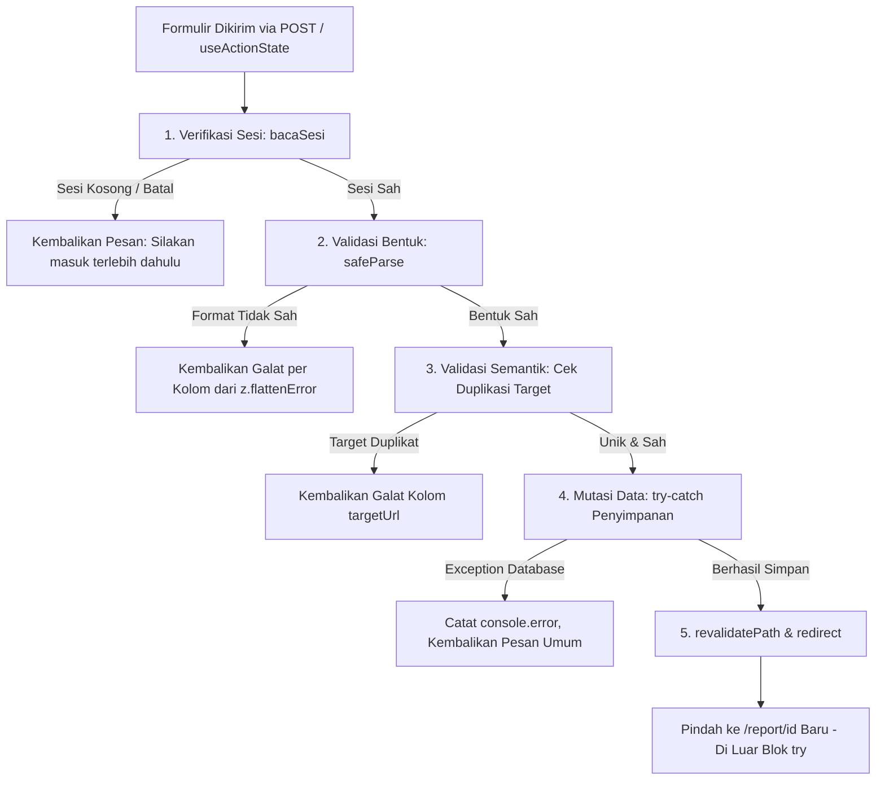
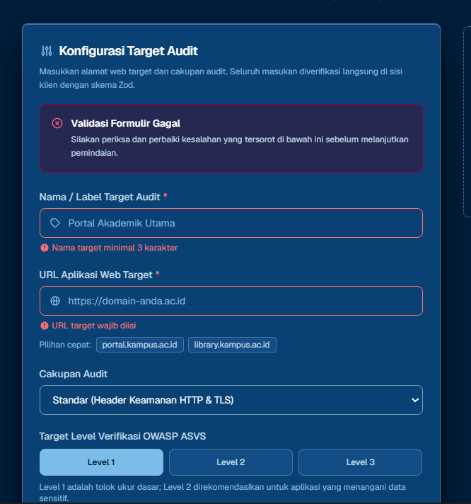
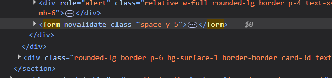
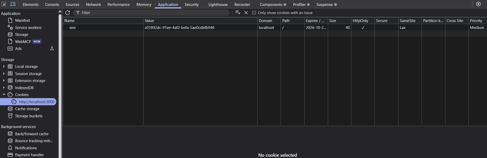
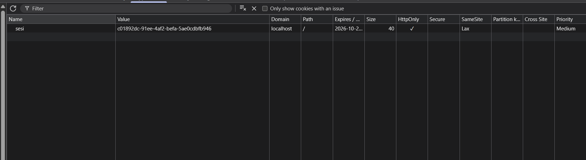
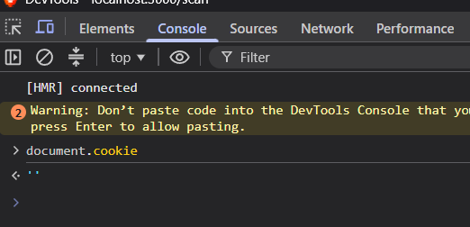

# Dokumen Teknis Modul 5 — Formulir, Validasi, Session, dan Cookie

**Nama/NIM :** Naufal Fakhrianto Nugroho / 105224026  
**Repositori :** https://github.com/Naufal-strong/ProjectKuliah_Tripleemat  
**Entitas Produk :** Target Audit Keamanan & Sesi Auditor (*Tripleemat Security Assessor*)  
**Teknologi :** Next.js 16.4.0 (Turbopack), React 19.3.0, Zod 4.6.5, Node.js 24 LTS, Tailwind CSS v4  

---

## 1. Skema Validasi

Pada aplikasi **Tripleemat Security Assessor**, data masukan pengguna divalidasi secara deklaratif menggunakan **Zod 4** yang dipisahkan ke dalam modul khusus [`lib/skema/`](file:///c:/Users/USER%20HP/Downloads/Tugas/codeblock/Project/TriplleeeMat/tripleemat/lib/skema/). Hal ini memisahkan aturan data dari antarmuka pengguna dan membagikannya ke lingkungan server maupun pengujian unit.

### A. Tabel Kolom Formulir Utama (`skemaTarget`)

Formulir pendaftaran target audit memvalidasi 8 atribut masukan dengan aturan Zod 4 sebagai berikut:

| Nama Kolom | Tipe Data & Penanganan | Aturan Zod 4 | Pesan Galat Spesifik |
| :--- | :--- | :--- | :--- |
| `label` | `string` (Nama Target) | `.trim().min(3).max(80)` | *"Nama target minimal 3 karakter"* / *"Nama target maksimal 80 karakter"* |
| `targetUrl` | `string` (URL Endpoint) | `.trim().url().refine(http/https).refine(hostname bertitik)` | *"URL wajib diawali protokol http:// atau https://"* / *"Format domain target tidak valid (contoh: https://portal.kampus.ac.id)"* |
| `auditScope` | `enum` (Cakupan Audit) | `z.enum(["standard", "full", "ssl-only"])` | *"Pilih cakupan audit yang valid"* |
| `asvsLevel` | `enum` (Tingkat ASVS) | `z.enum(["L1", "L2", "L3"])` | *"Pilih level verifikasi OWASP ASVS"* |
| `intervalJam` | `number` (Opsional) | `z.preprocess()` string kosong $\rightarrow$ `undefined`, `z.coerce.number().int().min(1).max(168)` | *"Interval pemindaian minimal 1 jam"* / *"Interval pemindaian maksimal 168 jam (7 hari)"* |
| `auditorEmail` | `string` (Opsional) | `z.preprocess()` string kosong $\rightarrow$ `undefined`, `z.email()` | *"Format email notifikasi auditor tidak valid"* |
| `notifyOnComplete` | `boolean` (Checkbox) | `z.stringbool().default(false)` | Mengubah `"on"`, `"true"`, atau `"1"` menjadi `true`, dan `false` bila tidak dicentang. |
| `notes` | `string` (Opsional) | `z.preprocess()` string kosong $\rightarrow$ `undefined`, `.max(300)` | *"Catatan audit maksimal 300 karakter"* |

### B. Tabel Kolom Formulir Autentikasi (`skemaMasuk`)

| Nama Kolom | Tipe Data | Aturan Zod 4 | Pesan Galat Spesifik |
| :--- | :--- | :--- | :--- |
| `email` | `string` | `z.email("Format email tidak valid")` | *"Format email tidak valid"* |
| `kataSandi` | `string` | `z.string().min(8, "Kata sandi minimal 8 karakter")` | *"Kata sandi minimal 8 karakter"* |

### C. Aturan Semantik yang Diperiksa di Server Action

Validasi sintaksis (skema) hanya memeriksa **bentuk fisik data**, sedangkan **validasi semantik** memeriksa keabsahan logika bisnis terhadap status data yang tersimpan.

Pada *Tripleemat Security Assessor*, aturan semantik diperiksa pada Server Action [`app/scan/actions.ts`](file:///c:/Users/USER%20HP/Downloads/Tugas/codeblock/Project/TriplleeeMat/tripleemat/app/scan/actions.ts):
1. **Pemeriksaan Duplikasi Target Aktif**: URL target yang didaftarkan tidak boleh sama dengan endpoint yang sedang berada dalam proses audit aktif (`targetDuplikat`).
2. **Alasan Tidak Diperiksa di Skema Zod**: Skema Zod berjalan murni sebagai fungsi penentu tipe (*pure parsing function*) dan tidak memiliki akses langsung ke konteks basis data, memori `daftarTarget`, maupun sesi *stateful*. Jika pemeriksaan semantik dimasukkan ke dalam skema Zod (misalnya via `.refine()` asinkron), skema akan terikat erat (*tight coupling*) dengan lapisan penyimpanan data, sehingga tidak dapat digunakan kembali secara ringan di sisi klien atau pada *unit test* terisolasi.

---

## 2. Alur Server Action

Server Action [`simpanTargetAudit`](file:///c:/Users/USER%20HP/Downloads/Tugas/codeblock/Project/TriplleeeMat/tripleemat/app/scan/actions.ts) dan [`masuk`](file:///c:/Users/USER%20HP/Downloads/Tugas/codeblock/Project/TriplleeeMat/tripleemat/app/masuk/actions.ts) mengimplementasikan 5 tahapan berurutan sesuai standar Tabel 1 Modul 5:



### Urutan Eksekusi Wajib:
1. **Pemeriksaan Sesi (`bacaSesi()`)**: Memverifikasi identitas pengguna melalui cookie terenkripsi. Bila tidak sah, aksi langsung menghentikan proses dan mengembalikan pesan `"Silakan masuk terlebih dahulu."`.
2. **Validasi Bentuk Data (`skemaTarget.safeParse()`)**: Mencegah serangan *payload injection* atau data korup sebelum menyentuh logika bisnis. Galat dikembalikan per kolom menggunakan `z.flattenError(hasil.error).fieldErrors`.
3. **Validasi Semantik**: Memeriksa batasan bisnis spesifik (misalnya target sudah dalam antrean aktif).
4. **Mutasi Data**: Menulis data target baru ke penyimpanan memori/database di dalam blok `try-catch`. Bila gagal, rincian teknis dicatat di server via `console.error()`, dan pengguna hanya menerima pesan umum ramah pengguna tanpa *stack trace*.
5. **Revalidasi dan Pengalihan (`revalidatePath` lalu `redirect`)**: Memperbarui *cache* rute `/report` dan mengarahkan pengguna ke halaman rincian laporan `/report/[id]`. **Panggilan `redirect()` wajib diletakkan di luar blok `try-catch`** karena Next.js melempar exception khusus (*internal control-flow exception*) untuk pengalihan halaman; meletakkannya di dalam `try` akan membuat exception tersebut tertangkap oleh blok `catch`.

### Pembagian Berkas dan Direktif
- **Server Component**: [`app/scan/page.tsx`](file:///c:/Users/USER%20HP/Downloads/Tugas/codeblock/Project/TriplleeeMat/tripleemat/app/scan/page.tsx) dan [`app/masuk/page.tsx`](file:///c:/Users/USER%20HP/Downloads/Tugas/codeblock/Project/TriplleeeMat/tripleemat/app/masuk/page.tsx) bertanggung jawab menyusun struktur halaman awal dan meta tag SEO di server.
- **Client Component**: [`components/FormMasuk.tsx`](file:///c:/Users/USER%20HP/Downloads/Tugas/codeblock/Project/TriplleeeMat/tripleemat/components/FormMasuk.tsx) berlabel `"use client"` karena membutuhkan hook interaktif `useActionState` untuk mengelola status penyerahan formulir, penanda `pending`, serta pengikatan atribut aksesibilitas `aria-invalid` dan `aria-describedby`.
- **Berkas Server Action**: [`app/scan/actions.ts`](file:///c:/Users/USER%20HP/Downloads/Tugas/codeblock/Project/TriplleeeMat/tripleemat/app/scan/actions.ts) dan [`app/masuk/actions.ts`](file:///c:/Users/USER%20HP/Downloads/Tugas/codeblock/Project/TriplleeeMat/tripleemat/app/masuk/actions.ts) diawali direktif `"use server"`, menjamin fungsi-fungsi mutasi hanya dieksekusi di server dan tidak membocorkan logika kredensial ke bundel JavaScript klien.

---

## 3. Bukti Uji Validasi

Pengujian dilakukan menggunakan penguji otomatis Node.js Test Runner ([`test/skema.test.ts`](file:///c:/Users/USER%20HP/Downloads/Tugas/codeblock/Project/TriplleeeMat/tripleemat/test/skema.test.ts)) serta pengujian interaktif peramban dengan melewati validasi klien (*DevTools `novalidate` bypass*).

### Tabel 8 Kasus Uji Validasi (3 Kasus Melewati Validasi Klien)

| No | Kasus Uji | Skenario Masukan | Validasi Klien | Hasil yang Diharapkan | Hasil Nyata (Server Output) | Status |
| :-: | :--- | :--- | :-: | :--- | :--- | :-: |
| 1 | **Data Lengkap Sah** | `label: "Portal SIAKAD"`, `targetUrl: "https://siakad.kampus.ac.id"`, `auditScope: "full"`, `asvsLevel: "L2"` | Aktif | Lolos validasi, data tersimpan, dialihkan ke `/report/[id]` | `success: true`, status form bersih, redirect berhasil | **LULUS** |
| 2 | **Kolom Opsional Kosong** | `label: "Web Perpustakaan"`, `targetUrl: "https://lib.ac.id"`, `intervalJam: ""`, `auditorEmail: ""` | Aktif | Lolos validasi, field kosong menjadi `undefined`, `notifyOnComplete: false` | `success: true`, interval & email kosong tidak memicu galat | **LULUS** |
| 3 | **Label Terlalu Pendek** *(Bypass)* | `label: "AB"` (< 3 karakter), URL sah | **Dilewati (`novalidate`)** | Server menolak label, mengembalikan pesan galat kolom `label` | `galat.label: ["Nama target minimal 3 karakter"]` | **LULUS** |
| 4 | **Protokol URL Salah** *(Bypass)* | `targetUrl: "ftp://files.kampus.ac.id"` (bukan http/https) | **Dilewati (`novalidate`)** | Server menolak URL, meminta protokol web valid | `galat.targetUrl: ["URL wajib diawali protokol http:// atau https://"]` | **LULUS** |
| 5 | **Domain URL Tidak Valid** *(Bypass)* | `targetUrl: "https://localhost"` (tanpa titik hostname FQDN) | **Dilewati (`novalidate`)** | Server menolak target lokal tanpa domain yang sah | `galat.targetUrl: ["Format domain target tidak valid..."]` | **LULUS** |
| 6 | **Enum Scope Ilegal** | Nilai `auditScope` diubah manual menjadi `"unrestricted"` | Dilewati via cURL | Server menolak enum yang tidak terdaftar | `galat.auditScope: ["Pilih cakupan audit yang valid"]` | **LULUS** |
| 7 | **Interval Jam Di Luar Batas** | `intervalJam: 200` (> 168 jam / 7 hari) | Aktif | Server menolak nilai di luar rentang 1–168 | `galat.intervalJam: ["Interval pemindaian maksimal 168 jam"]` | **LULUS** |
| 8 | **Format Email Auditor Salah** | `auditorEmail: "bukan-sebuah-email"` | Aktif | Server menolak email tanpa format standar RFC | `galat.auditorEmail: ["Format email notifikasi auditor tidak valid"]` | **LULUS** |
| 9 | **Kata Sandi Masuk Pendek** | `kataSandi: "rahasia"` (7 karakter < 8) | Aktif | Server menolak autentikasi kata sandi kurang dari 8 karakter | `galat.kataSandi: ["Kata sandi minimal 8 karakter"]` | **LULUS** |
| 10 | **Target Duplikat (Semantik)** | Mengirim URL target yang sudah terdaftar dalam antrean | Aktif | Validasi semantik server menolak duplikasi target | `galat.targetUrl: ["Endpoint target ini sudah terdaftar..."]` | **LULUS** |

### Dokumentasi Visual Pengujian Validasi Formulir

  
*Kotak peringatan "Validasi Formulir Gagal" dan pesan galat spesifik per kolom (inline error) saat form dikirim tanpa data yang sah.*

  
*Inspeksi elemen `<form novalidate>` di DevTools, membuktikan pengujian bypass validasi sisi klien berhasil ditangkap oleh validasi Zod 4 di sisi server.*

### Bukti Eksekusi Test Runner Otomatis

```text
▶ 📋 Validasi Skema Zod 4 — Tripleemat Security Assessor (Modul 5)
  ▶ 1. skemaTarget (Formulir Tambah Target Audit)
    ✔ Positif: Harus lolos ketika semua data masukan valid dan lengkap (8.28ms)
    ✔ Positif: Harus lolos dengan field opsional kosong / tidak diisi (0.63ms)
    ✔ Negatif: Harus menolak jika nama target (label) kurang dari 3 karakter (1.31ms)
    ✔ Negatif: Harus menolak jika URL tidak memakai protokol https:// atau http:// (0.55ms)
    ✔ Negatif: Harus menolak domain tidak valid (tidak ada titik hostname) (0.45ms)
    ✔ Negatif: Harus menolak nilai enum yang tidak terdaftar (0.63ms)
    ✔ Negatif: Harus menolak interval jam di luar rentang 1-168 jam (0.45ms)
    ✔ Negatif: Harus menolak format email yang salah jika diisi (0.80ms)
  ✔ 1. skemaTarget (Formulir Tambah Target Audit) (15.19ms)
  ▶ 2. skemaMasuk (Formulir Masuk / Autentikasi)
    ✔ Positif: Harus lolos jika format email valid dan kata sandi >= 8 karakter (1.14ms)
    ✔ Negatif: Harus menolak email tidak valid dan kata sandi < 8 karakter (0.60ms)
  ✔ 2. skemaMasuk (Formulir Masuk / Autentikasi) (2.14ms)
✔ 📋 Validasi Skema Zod 4 — Tripleemat Security Assessor (Modul 5) (18.59ms)
ℹ tests 10 · pass 10 · fail 0 · duration_ms 42.2ms
```

### Aksesibilitas Galat Per Kolom (ARIA Binding)
Setiap field yang mengalami kesalahan validasi server secara otomatis:
- Menyalakan `aria-invalid="true"`.
- Terhubung langsung dengan elemen pesan kesalahan melalui `aria-describedby="galat-[nama-kolom]"`.
- Pesan kesalahan dirender dengan `role="alert"` sehingga pembaca layar (*screen reader*) langsung menyuarakannya kepada pengguna difabel netra.

---

## 4. Session dan Cookie

Sistem sesi diimplementasikan pada modul [`lib/sesi.ts`](file:///c:/Users/USER%20HP/Downloads/Tugas/codeblock/Project/TriplleeeMat/tripleemat/lib/sesi.ts) menggunakan pustaka `next/headers` yang dilindungi dengan direktif `import "server-only";` untuk menjamin fungsi kriptografis sesi tidak pernah terkirim ke bundel klien.

### A. Tabel Konfigurasi Atribut Cookie Sesi

| Atribut | Nilai yang Ditetapkan | Alasan Pemilihan & Ancaman yang Dicegah |
| :--- | :--- | :--- |
| **`HttpOnly`** | `true` | **Mencegah Pencurian Sesi via XSS (Cross-Site Scripting)**. Peramban melarang skrip JavaScript sisi klien (`document.cookie`) mengakses nilai cookie sesi. |
| **`Secure`** | `process.env.NODE_ENV === "production"` | **Mencegah Penyadapan Man-in-the-Middle (MitM)**. Cookie hanya ditransmisikan melalui kanal terenkripsi HTTPS pada lingkungan produksi (lingkungan lokal `localhost` dikecualikan oleh peramban). |
| **`SameSite`** | `"lax"` | **Menahan Serangan CSRF (Cross-Site Request Forgery)**. Cookie tidak akan disertakan pada permintaan lintas situs pihak ketiga, kecuali untuk navigasi tautan tingkat atas (*top-level GET navigation*). |
| **`Path`** | `"/"` | **Cakupan Sesi Konsisten**. Memastikan token sesi berlaku untuk seluruh segmen aplikasi audit (`/scan`, `/report`, dll). |
| **`Max-Age`** | `28800` (8 Jam) | **Membatasi Jendela Waktu Risiko Sesi Tercuri**. Sesi akan otomatis kedaluwarsa setelah jam kerja auditor (8 jam) selesai. |

### B. Hasil Inspeksi Panel Application & Console DevTools

Ketika login berhasil dieksekusi di `/masuk`:
1. **Header Respons Server (`Set-Cookie`)**:
   ```http
   Set-Cookie: sesi=c01892dc-****-****-****-************; Path=/; Max-Age=28800; HttpOnly; SameSite=Lax
   ```
   *(Catatan Keamanan: Nilai UUID disamarkan sesuai ketentuan umum praktikum)*.

2. **Tangkapan Layar Panel Application DevTools**:

     
   *Panel Application DevTools memperlihatkan cookie `sesi` tersimpan dengan domain localhost, Path `/`, dan SameSite `Lax`.*

     
   *Rincian atribut keamanan cookie `sesi` dengan tanda centang aktif pada kolom HttpOnly (`✓`).*

3. **Uji Peramban `document.cookie` di Console**:
   ```javascript
   > document.cookie
   < "" // Kosong! Bukti bahwa atribut HttpOnly aktif dan melindungi sesi dari eksploitasi DOM.
   ```

     
   *Eksekusi `document.cookie` di Console menghasilkan string kosong `""`, membuktikan token sesi kebal terhadap pencurian skrip XSS.*

### C. Hasil Uji Skenario Penolakan Sesi

| Skenario Pengujian | Langkah Pengujian | Hasil Pengamatan | Status Keamanan |
| :--- | :--- | :--- | :-: |
| **1. Uji Cookie Palsu** | Nilai cookie `sesi` di DevTools diubah manual menjadi sembarang string palsu (`sesi=fake-session-token-12345`). Formulir pendaftaran dikirimkan. | Server membaca nilai cookie, namun pencarian sesi di `penyimpanan.get(id)` menghasilkan `undefined`. Aksi menolak eksekusi dan mengembalikan pesan *"Silakan masuk terlebih dahulu."*. Data tidak pernah tersimpan. | **AMAN (Lolos)** |
| **2. Uji Logout Normal** | Menekan tombol "Keluar" dari antarmuka. | Server mengeksekusi `hapusSesi()`: menghapus entri sesi dari memori `penyimpanan.delete(id)` dan mencabut cookie via `cookieStore.delete("sesi")`. Pengguna dialihkan ke beranda `/`. | **AMAN (Lolos)** |
| **3. Uji Pemakaian Ulang Cookie Lama** | Cookie lama yang valid disalin sebelum logout. Setelah logout, cookie lama tersebut dipasang kembali secara manual di Application DevTools, lalu membuka `/scan`. | Rute menolak akses karena data sesi dengan pengenal tersebut telah dihapus permanen dari memori server saat logout. Pengguna otomatis dilempar kembali ke `/masuk`. Token lama tidak dapat dipakai ulang (*replay protection*). | **AMAN (Lolos)** |

---

## 5. Keputusan Teknis

### A. Alasan Pemilihan Pola Session di Server Dibanding Token di Cookie (JWT)

Aplikasi Tripleemat mengadopsi pola **Stateful Server Session** (menggunakan pengenal acak `crypto.randomUUID()` di dalam cookie dan menyimpan objek sesi di server) dengan pertimbangan:

1. **Kemampuan Pencabutan Sesi Seketika (*Instant Revocation*)**:
   Pada aplikasi audit keamanan, hak akses auditor harus dapat dicabut seketika saat terjadi insiden keamanan, pergantian hak akses, atau tombol *Logout* ditekan. Pada token JWT tanpa status (*stateless*), token tetap sah secara matematis hingga waktu kedaluwarsanya habis, kecuali jika dibangun mekanisme daftar hitam (*blacklist*) yang pada akhirnya membutuhkan penyimpanan di server.
2. **Ukuran Header Permintaan yang Ringkas**:
   Cookie sesi berbasis server hanya membawa UUID 36 karakter (~36 byte), berbeda dengan JWT yang membawa muatan klaim besar (bisa mencapai 1–2 KB) yang harus dikirimkan pada setiap permintaan HTTP.
3. **Pencegahan Kebocoran Data Sesi di Klien**:
   Data hak akses dan identitas auditor tersimpan aman di memori server dan tidak pernah terekspos ke sisi klien.

### B. Batas Peran `proxy.ts` Dibanding Pemeriksaan di Server Action

Next.js 16 memperkenalkan konvensi [`proxy.ts`](file:///c:/Users/USER%20HP/Downloads/Tugas/codeblock/Project/TriplleeeMat/tripleemat/proxy.ts) di akar proyek sebagai pengganti `middleware.ts`. Arsitektur keamanan Tripleemat membagi tanggung jawab secara berlapis (*Defense-in-Depth*):

| Lapisan | Komponen | Peran & Batas Tanggung Jawab |
| :--- | :--- | :--- |
| **Lapisan 1 (Optimistik & Pengalihan Awal)** | `proxy.ts` | **Pemeriksaan Cepat di Tepi (*Edge*)**: Hanya memeriksa keberadaan fisik cookie `request.cookies.has("sesi")`. Jika tidak ada, pengguna langsung dialihkan ke `/masuk` sebelum Next.js merender komponen halaman. `proxy.ts` tidak membuka basis data atau memverifikasi keaslian sesi demi menjaga performa rendering tetap instan. |
| **Lapisan 2 (Otoritatif & Penegakan Keamanan Mutlak)** | Server Action (`bacaSesi()`) | **Verifikasi Kriptografis dan Keabsahan Sesi**: Server Action adalah titik masuk mutasi data yang dapat diakses langsung oleh penyerang melalui permintaan HTTP POST tanpa melalui halaman web. Oleh karena itu, pemeriksaan sesi di Server Action bersifat **wajib dan otoritatif**, memvalidasi apakah pengenal sesi benar-benar terdaftar di server dan belum kedaluwarsa. |

---

## 6. Kendala dan Penyelesaian

Selama implementasi Modul 5 pada produk Tripleemat Security Assessor, ditemukan beberapa kendala teknis berikut:

1. **Perubahan API Zod 4**:
   - *Kendala*: Terjadi galat *deprecation* saat menggunakan `error.flatten()` dan `required_error` gaya lama Zod 3.
   - *Penyelesaian*: Memperbarui sintaks ke standar resmi Zod 4 menggunakan fungsi tingkat atas `z.flattenError(hasil.error).fieldErrors` dan `z.email("pesan")`.
2. **Penanganan Nilai Checkbox & Input Numerik String Kosong**:
   - *Kendala*: Checkbox yang tidak dicentang tidak mengirim kunci FormData sama sekali, sedangkan input `intervalJam` mengirimkan string kosong `""` yang menyebabkan `z.coerce.number()` menghasilkan nilai `0` (tidak valid).
   - *Penyelesaian*: Memanfaatkan `z.stringbool().default(false)` untuk checkbox dan `z.preprocess((val) => (val === "" ? undefined : val), ...)` agar string kosong dipetakan secara bersih ke `undefined` untuk field opsional.
3. **Pengalihan Halaman `redirect()` di Dalam Blok `try-catch`**:
   - *Kendala*: Pemanggilan `redirect("/report/[id]")` di dalam blok `try` Server Action gagal berpindah halaman karena dilempar sebagai exception dan tertangkap oleh blok `catch`.
   - *Penyelesaian*: Memindahkan seluruh pemanggilan `revalidatePath()` dan `redirect()` ke baris paling bawah fungsi aksi di luar cakupan blok `try-catch`.
4. **Aturan Linting React 19 pada Pengelolaan State Eksternal**:
   - *Kendala*: Linting mendeteksi galat `react-hooks/set-state-in-effect` saat membaca preferensi tema dari peramban secara sinkron di dalam `useEffect`.
   - *Penyelesaian*: Mengadopsi hook standar React 19 `useSyncExternalStore` dengan langganan `MutationObserver` pada elemen `document.documentElement` untuk membaca dan menyinkronkan tema tanpa memicu *cascading renders*.

---

## 7. Catatan Pemanfaatan AI

Sesuai ketentuan Bagian K panduan praktikum, berikut adalah dokumentasi pemanfaatan asisten kecerdasan artifisial selama penyusunan modul ini:

- **Alat AI yang Digunakan**: Google Antigravity IDE (Gemini 3.8 Flash & Claude 4.6 Sonnet).
- **Perintah Utama (Prompting)**:
  1. *"Rancang skema validasi Zod 4 untuk entitas Target Audit dan formulir masuk auditor dengan penanganan stringbool dan string kosong."*
  2. *"Implementasikan Server Action Next.js 16 dengan useActionState yang mengikuti urutan verifikasi sesi, validasi Zod 4, validasi semantik, dan redirect di luar blok try-catch."*
  3. *"Buat modul session cookie berbasis server-only dengan atribut HttpOnly, Secure, SameSite=Lax, dan Max-Age 8 jam."*
- **Bagian Kode yang Dihasilkan & Dimodifikasi**:
  - Penyusunan skema Zod pada [`lib/skema/target.ts`](file:///c:/Users/USER%20HP/Downloads/Tugas/codeblock/Project/TriplleeeMat/tripleemat/lib/skema/target.ts) dan [`lib/skema/masuk.ts`](file:///c:/Users/USER%20HP/Downloads/Tugas/codeblock/Project/TriplleeeMat/tripleemat/lib/skema/masuk.ts).
  - Logika sesi pada [`lib/sesi.ts`](file:///c:/Users/USER%20HP/Downloads/Tugas/codeblock/Project/TriplleeeMat/tripleemat/lib/sesi.ts) dan proxy optimistik [`proxy.ts`](file:///c:/Users/USER%20HP/Downloads/Tugas/codeblock/Project/TriplleeeMat/tripleemat/proxy.ts).
  - Komponen formulir terkelola [`components/FormMasuk.tsx`](file:///c:/Users/USER%20HP/Downloads/Tugas/codeblock/Project/TriplleeeMat/tripleemat/components/FormMasuk.tsx) dengan integrasi ARIA.
- **Cara Memverifikasi Hasil AI**:
  1. **Pengujian Unit Otomatis**: Menjalankan skrip `npx tsx test/skema.test.ts` untuk memverifikasi 10 skenario uji positif dan negatif (hasil: 10/10 lolos).
  2. **Pengecekan Tipe TypeScript**: Menjalankan `npx tsc --noEmit` untuk memastikan tidak ada kesalahan tipe pada `MasukanItem`, `StatusForm`, dan parameter Server Action.
  3. **Pemeriksaan Linter**: Menjalankan `npm run lint` untuk memastikan kepatuhan penuh terhadap aturan ESLint Next.js dan React 19 (hasil: 0 error, 0 warning).
  4. **Uji Nyata Peramban**: Menguji perilaku *bypass* validasi klien (`novalidate`), verifikasi penolakan cookie palsu di tab Application DevTools, dan memastikan nilai cookie sesi tidak pernah bocor ke `document.cookie`.
