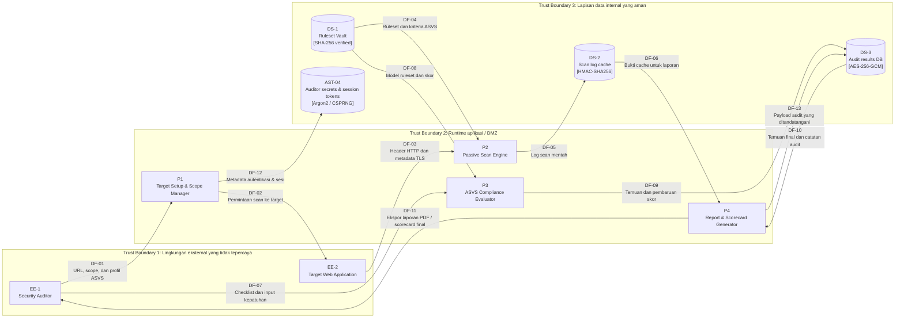

# DFD — Tripleemat Security Assessor

Tag: `sec-0.1`

DFD ini merefleksikan implementasi produk Tripleemat saat ini: aplikasi web Next.js dengan validasi form scan, analisis HTTP/TLS pasif, evaluasi matriks OWASP ASVS, pembuatan laporan, dan verifikasi kriptografi yang diimplementasikan di `src/lib/crypto`.

## Diagram Aliran Data

## Inventaris Elemen

- EE-1: Security Auditor / pengguna yang memasukkan URL target dan menerima laporan.
- EE-2: Aplikasi web target yang sedang diaudit.
- P1: Target setup and scope manager, termasuk validasi nilai URL/host pada alur form `/scan`.
- P2: Passive security and SSL scanner engine, yang membaca header HTTP dan metadata TLS.
- P3: ASVS compliance evaluator, yang membandingkan temuan target dengan control ASVS dan menghasilkan bukti skor.
- P4: Report and scorecard generator yang membuat output yang dapat diekspor untuk auditor.
- DS-1: Ruleset vault yang menyimpan kriteria ASVS dan definisi scoring.
- DS-2: Raw scan cache untuk metadata respons dan temuan sementara.
- DS-3: Database hasil audit persisten dengan artefak laporan yang ditandatangani.
- AST-04: Penyimpanan secret auditor dan token sesi.

## Batas Kepercayaan (Trust Boundaries)

1. TB-1: Batas eksternal yang tidak tepercaya antara browser auditor dan aplikasi target jarak jauh.
2. TB-2: Batas runtime aplikasi yang berisi Next.js runtime, logic scanner, dan engine evaluasi kepatuhan.
3. TB-3: Batas data internal yang aman yang berisi ruleset vault, cache scan, database hasil, dan material secret.

## Aset yang Dilindungi Kriptografi

- DS-1: Diverifikasi dengan hash SHA-256 sebelum digunakan.
- DS-2: Melindungi bukti scan mentah dengan tanda tangan HMAC-SHA256.
- DS-3: Menyimpan temuan dengan enkripsi AES-256-GCM dan authenticated tag.
- AST-04: Menggunakan token CSPRNG OS dan hashing password berbasis Argon2 untuk secret dan material sesi.

## Catatan

- DFD ini menunjukkan alur permintaan dan data aktual dari produk, bukan platform penilaian keamanan generik.
- Data dianggap sensitif saat disimpan atau diekspor, terutama temuan audit, scorecard, dan material secret.
