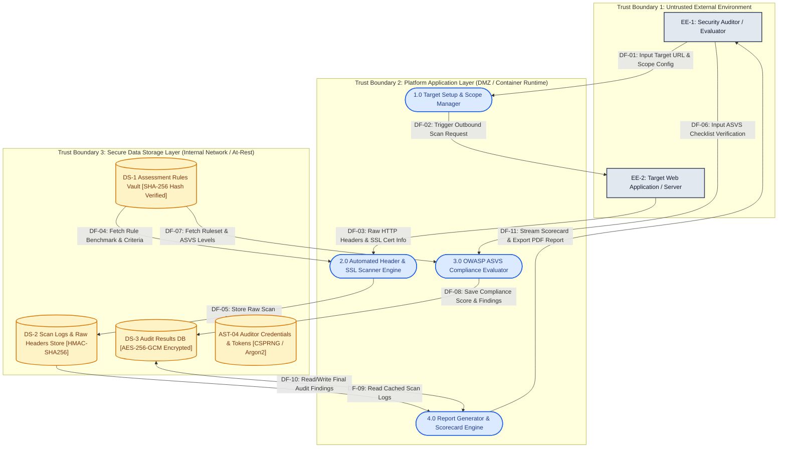

# 🛡️ Threat Modeling & Risk Assessment — Tripleemat Security Assessor

**Milestone:** `sec-0.1` — Threat, Vulnerability, and Risk Analysis  
**Metodologi:** STRIDE, DFD Level 0 (Shostack), NIST SP 800-30  
**Status Dokumen:** Approved / Baselines Established  
**Terakhir Diperbarui:** 2026-10-10  

Dokumen ini menyajikan pemodelan ancaman (*threat modeling*) komprehensif, evaluasi matriks risiko, dan rencana kontrol mitigasi untuk platform **Tripleemat Security Assessor**. Pemodelan ini dibangun berdasarkan elemen-elemen arsitektur sistem dan batas kepercayaan (*trust boundaries*).

---

## 1. Diagram Arsitektur & Aliran Data (DFD) dengan Batas Kepercayaan (Trust Boundaries)

Arsitektur sistem digambarkan melalui Data Flow Diagram (DFD) Level 0 yang membagi sistem ke dalam 3 zona kepercayaan (*Trust Boundaries*). 

> *Arsip visual diagram diagramatik juga tersedia pada berkas [DFD .png](file:///c:/Users/USER%20HP/Downloads/Tugas/codeblock/Project/TriplleeeMat/tripleemat/security/DFD%20.png).*

### Rincian Elemen DFD & Batas Kepercayaan

1. **Batas Kepercayaan (*Trust Boundaries*):**
   * **TB-1 (Untrusted External Environment):** Meliputi peramban pengguna (*Auditor Browser*) dan server web target yang diaudit. Lingkungan ini tidak tepercaya; seluruh input dari TB-1 diasumsikan bermusuhan (*hostile*).
   * **TB-2 (Platform Application Layer - DMZ):** Layanan aplikasi Next.js/Node.js yang memproses logika bisnis, validasi masukan, dan eksekusi pemindaian. Terlindungi oleh firewall aplikasi dan API gateway.
   * **TB-3 (Secure Data Storage Layer - Internal Network):** Basis data persisten dan repositori konfigurasi internal yang hanya dapat diakses melalui koneksi terotentikasi dan terlindung di balik *private subnet*.

2. **Entitas Eksternal (*External Entities*):**
   * **EE-1 (Security Auditor / Evaluator):** Aktor manusia yang mengonfigurasi lingkup audit, memicu pemindaian, dan mengunduh laporan.
   * **EE-2 (Target Web Application / Server):** Server eksternal sasaran audit yang merespons probe HTTP/SSL dari platform.

3. **Proses (*Processes*):**
   * **1.0 (Target Setup & Scope Manager):** Memvalidasi skema URL, port, dan otorisasi ruang lingkup pengujian.
   * **2.0 (Automated Header & SSL Scanner Engine):** Mengirim probe HTTP/TLS pasif, membaca header keamanan, dan menganalisis sertifikat TLS target.
   * **3.0 (OWASP ASVS Compliance Evaluator):** Menghitung skor kepatuhan berdasarkan checklist masukan auditor dan pemetaan kontrol ASVS.
   * **4.0 (Report Generator & Scorecard Engine):** Mengompilasi ringkasan eksekutif dan menerbitkan dokumen laporan hasil audit (PDF).

4. **Penyimpanan Data (*Data Stores*):**
   * **DS-1 (Assessment Rules Vault):** Berkas konfigurasi aturan (`asvs-rules.json`) yang wajib diverifikasi integritas hash-nya.
   * **DS-2 (Scan Logs & Raw Headers Store):** Penyimpanan sementara data respons HTTP mentah (Redis / in-memory cache).
   * **DS-3 (Audit Results DB):** Database hasil temuan kerentanan dan skor kepatuhan target.
   * **AST-04 (Auditor Credentials & Secrets):** Penyimpanan hash kredensial dan token sesi aktif.

---

## 2. Identifikasi Model Ancaman STRIDE (Minimal 10 Ancaman)

Ancaman diidentifikasi dengan memetakan setiap kategori STRIDE (*Spoofing, Tampering, Repudiation, Information Disclosure, Denial of Service, Elevation of Privilege*) ke elemen-elemen DFD:

| ID Ancaman | Kategori STRIDE | Elemen DFD Terkait | Deskripsi Skenario Ancaman | Dampak Teknis & Bisnis |
| :--- | :--- | :--- | :--- | :--- |
| **TH-01** | **Spoofing** | EE-1, P1, AST-04 | **Auditor Identity Spoofing:** Penyerang memalsukan identitas auditor menggunakan token sesi curian atau kredensial yang ditebak untuk mengakses platform. | Akses tidak sah ke modul pemindaian dan kebocoran riwayat audit klien lain. |
| **TH-02** | **Spoofing** | EE-2, P2, DF-03 | **Target Server Spoofing (DNS Hijack / MitM):** Penyerang membelokkan resolusi DNS target web agar scanner menginspeksi server palsu dengan konfigurasi TLS sempurna. | Menghasilkan hasil audit palsu (*false negative*) yang meloloskan target rentan. |
| **TH-03** | **Tampering** | DS-1, DF-04, P2, P3 | **Assessment Ruleset Tampering:** Penyerang atau pihak internal mengubah kriteria evaluasi pada `asvs-rules.json` untuk menurunkan passing grade audit. | Standar kepatuhan menjadi bias; menurunkan kepercayaan integritas platform. |
| **TH-04** | **Tampering** | DS-3, DF-08, DF-10 | **Audit Scorecard Manipulation in DB:** Penyerang memodifikasi nilai kerentanan target langsung pada tabel database sebelum laporan dicetak. | Memanipulasi sertifikat kelayakan keamanan siber target secara curang. |
| **TH-05** | **Repudiation** | EE-1, P1, DF-01 | **Audit Scope Request Repudiation:** Auditor menyangkal telah memasukkan URL target ilegal (di luar izin *authorized scope*) saat terjadi keluhan hukum dari pemilik server. | Platform tidak dapat membuktikan kepemilikan aksi audit karena ketiadaan log bertanda tangan digital. |
| **TH-06** | **Repudiation** | P2, DS-2, DF-05 | **Scan Evidence Repudiation:** Pemilik web target menyangkal temuan celah keamanan dengan mengklaim bukti raw response header pada DS-2 telah dimanipulasi platform. | Laporan audit kehilangan kekuatan pembuktian teknis dan hukum. |
| **TH-07** | **Information Disclosure** | DS-3, DF-10, DF-11 | **Vulnerability Data Breach at Rest/Transit:** Kebocoran data hasil audit yang memuat daftar celah keamanan target yang belum ditambal (*unpatched vulnerabilities*). | Penyerang eksternal dapat mengeksploitasi celah target yang terungkap dalam laporan. |
| **TH-08** | **Information Disclosure** | P1, EE-2, DF-02 | **Server-Side Request Forgery (SSRF):** Penyerang memasukkan target URL internal (`http://169.254.169.254`, `http://localhost:5432`) untuk memetakan jaringan privat internal Tripleemat. | Penyerang membaca metadata cloud instance atau berinteraksi langsung dengan database internal. |
| **TH-09** | **Denial of Service** | P2, EE-2, DF-02, DF-03 | **Scanner Worker Exhaustion (Slowloris/Tar-pit Target):** Target web sengaja merespons sangat lambat (*trickle response*) atau melakukan rekursif redirect tak berujung. | Worker Node.js terkuras dan macet, menyebabkan kegagalan pemindaian bagi pengguna lain. |
| **TH-10** | **Denial of Service** | DS-2, DS-3, DF-05 | **Storage Exhaustion via Scan Flooding:** Penyerang memicu ribuan permintaan scan simultan dengan ukuran response header artifisial masif untuk memenuhi memori/disk. | Sistem crash akibat *Out of Memory* (OOM) atau disk penuh, melumpuhkan seluruh platform. |
| **TH-11** | **Elevation of Privilege** | P1, P3, EE-1 | **Privilege Escalation via Broken Access Control:** Pengguna dengan peran *Viewer* atau *Auditor Junior* memanipulasi parameter peran untuk mengakses hak *Administrator*. | Auditor biasa dapat mengubah konfigurasi global dan menghapus log audit. |
| **TH-12** | **Elevation of Privilege** | P4, DF-10, DF-11 | **Report Engine Remote Code Execution (Template Injection):** Penyerang menyisipkan payload HTML/CSS jahat ke dalam header target yang dieksekusi oleh modul PDF renderer. | Pengambilalihan kendali penuh atas sistem operasi host melalui sandbox escape engine PDF. |

---

## 3. Penilaian Kemungkinan (Likelihood), Dampak (Impact), dan Matriks Risiko

Penilaian risiko dilakukan dengan mengalikan probabilitas kejadian (*Likelihood*) dan tingkat keparahan konsekuensi (*Impact*) sesuai metodologi **NIST SP 800-30**.

### Kriteria Matriks Risiko:
* **Likelihood:** Low (Jarang/Sulit dieksploitasi), Medium (Mungkin terjadi/Alat umum tersedia), High (Sangat mungkin/Sangat mudah dieksploitasi).
* **Impact:** Low (Dampak minor/operasional lokal), Medium (Dampak moderat/kerugian finansial & waktu terbatas), High (Dampak fatal/kerugian hukum, kebocoran data rahasia massal, kompromi integritas total).
* **Tingkat Risiko:**
  * **Critical:** High Likelihood + High Impact, atau Medium Likelihood + High Impact pada komponen inti.
  * **High:** High Likelihood + Medium Impact, atau Medium Likelihood + High Impact.
  * **Medium:** Medium Likelihood + Medium Impact, atau High Likelihood + Low Impact.
  * **Low:** Low Likelihood + Low/Medium Impact.

### Tabel Penilaian Seluruh Ancaman

| ID Ancaman | Deskripsi Singkat | Kemungkinan (Likelihood) | Dampak (Impact) | Tingkat Risiko | Status Prioritas |
| :---: | :--- | :---: | :---: | :---: | :---: |
| **TH-01** | Auditor Identity Spoofing | Medium | High | **HIGH** | Kandidat Prioritas 5 |
| **TH-02** | Target Server Spoofing (DNS MitM) | Low | Medium | **LOW** | Terkelola |
| **TH-03** | Assessment Ruleset Tampering | Medium | High | **CRITICAL** | **Prioritas 2** |
| **TH-04** | Audit Scorecard Manipulation in DB | Low | High | **MEDIUM** | Terkelola |
| **TH-05** | Audit Scope Repudiation | Medium | Medium | **MEDIUM** | Terkelola |
| **TH-06** | Scan Evidence Repudiation | Low | Medium | **LOW** | Terkelola |
| **TH-07** | Vulnerability Data Breach at Rest/Transit | Medium | High | **CRITICAL** | **Prioritas 3** |
| **TH-08** | SSRF via Target URL Input | High | High | **CRITICAL** | **Prioritas 1** |
| **TH-09** | Scanner Worker Exhaustion (Slowloris/DoS) | High | Medium | **HIGH** | **Prioritas 4** |
| **TH-10** | Storage Exhaustion via Scan Flooding | Medium | Medium | **MEDIUM** | Terkelola |
| **TH-11** | Privilege Escalation to Admin Role | Medium | High | **HIGH** | **Prioritas 5** |
| **TH-12** | PDF Engine Template Injection / RCE | Low | High | **MEDIUM** | Terkelola |

---

## 4. Penetapan 5 Risiko Prioritas Utama & Justifikasi Konteks Produk

Berdasarkan karakteristik operasional **Tripleemat Security Assessor** sebagai platform pengujian keamanan berbasis web yang memproses URL pihak ketiga, mengevaluasi standar kepatuhan, dan menyimpan temuan kerentanan, ditetapkan **5 Risiko Prioritas Utama**:

### 🔴 Prioritas 1: Server-Side Request Forgery (SSRF) melalui Input Target URL (TH-08)
* **Elemen Terdampak:** Process 1.0 (Target Setup), Process 2.0 (Scanner Engine), Data Flow DF-02.
* **Justifikasi Berdasarkan Konteks Produk:**
  Tripleemat pada dasarnya adalah mesin yang menerima string URL dari pengguna lalu melakukan panggilan HTTP/TLS keluar (*outbound request*) atas nama server platform. Tanpa penyaringan ketat, penyerang dapat memasukkan alamat IP loopback (`127.0.0.1`), metadata cloud AWS/GCP (`169.254.169.254`), atau jaringan privat internal kampus/staging (RFC 1918). Kerentanan ini mengekspos seluruh data store internal (DS-1, DS-2, DS-3) dan kredensial hosting, mengubah fungsi scanner menjadi alat peretasan internal.

### 🔴 Prioritas 2: Manipulasi Integritas Ruleset Evaluasi ASVS (TH-03)
* **Elemen Terdampak:** Data Store DS-1 (Assessment Rules Vault), Process 3.0 (ASVS Evaluator).
* **Justifikasi Berdasarkan Konteks Produk:**
  Integritas adalah fondasi bisnis platform audit. Jika berkas aturan kepatuhan (`asvs-rules.json`) dapat dimodifikasi oleh penyerang atau malware pada host tanpa terdeteksi, skor kelayakan keamanan sistem target dapat dimanipulasi secara sepihak. Aplikasi target yang memiliki kerentanan kritis dapat memperoleh skor kepatuhan sempurna, yang menghancurkan kredibilitas hasil sertifikasi dan membahayakan keamanan publik.

### 🔴 Prioritas 3: Kebocoran Data Hasil Audit & Temuan Kerentanan Target (TH-07)
* **Elemen Terdampak:** Data Store DS-3 (Audit Results DB), Data Flows DF-08, DF-10, DF-11.
* **Justifikasi Berdasarkan Konteks Produk:**
  Data yang dikumpulkan platform mencakup daftar celah keamanan spesifik, header keamanan yang hilang, dan versi dependensi web target yang dievaluasi. Data ini memiliki klasifikasi kerahasiaan tinggi (**FIPS 199 Confidentiality: HIGH**). Apabila database atau kanal transmisi disadap, penyerang mendapatkan panduan eksploitasi instan (*zero-day reconnaissance map*) untuk meretas aplikasi klien yang diaudit.

### 🟠 Prioritas 4: Kelumpuhan Worker Scanner Akibat Target Berbahaya / Slowloris (TH-09)
* **Elemen Terdampak:** Process 2.0 (Scanner Engine), Entitas Luar EE-2 (Target Web).
* **Justifikasi Berdasarkan Konteks Produk:**
  Platform memindai entitas luar (EE-2) yang berada di luar kontrol (*Untrusted External Environment*). Server target yang jahat atau tidak kooperatif dapat merekayasa respons lambat (*tar-pit*), respons berukuran raksasa tak terhingga (*zip bomb/chunked loop*), atau *hanging sockets*. Karena arsitektur Node.js bergantung pada *event loop*, koneksi yang menggantung dapat menghabiskan soket jaringan dan memori, melumpuhkan fungsi audit platform secara luas.

### 🟠 Prioritas 5: Pemalsuan Sesi & Eskalasi Hak Akses Auditor (TH-01 & TH-11)
* **Elemen Terdampak:** AST-04 (Credentials & Tokens), Process 1.0, Process 3.0.
* **Justifikasi Berdasarkan Konteks Produk:**
  Platform ini digunakan oleh banyak evaluator dengan hierarki peran berbeda (*Guest*, *Junior Auditor*, *Lead Auditor*, *Platform Admin*). Jika generator token sesi dapat diprediksi (menggunakan PRNG lemah seperti `Math.random()`) atau kontrol otorisasi tidak divalidasi pada setiap API route, penyerang dapat mencuri sesi auditor berwenang untuk memicu audit ilegal atau menghapus catatan pelanggaran audit.

---

## 5. Rencana Kontrol (Control Plan) untuk Setiap Risiko Prioritas

Berikut adalah rencana kontrol terperinci dan dapat diuji secara teknis untuk masing-masing dari 5 risiko prioritas:

### 🛡️ Kontrol Plan 1: Pertahanan Mendalam Terhadap SSRF (Prioritas 1 — TH-08)
* **Strategi Mitigasi:** *Prevent & Detect* (Pencegahan Preventif dan Deteksi Dini).
* **Mekanisme Teknis:**
  1. **Validasi Skema & Parsing:** Hanya mengizinkan protokol `http://` dan `https://`. Menolak skema non-web (`file://`, `ftp://`, `gopher://`, `dict://`).
  2. **Resolusi DNS Pre-Flight & Blacklisting IP Privat:** Sebelum melakukan request HTTP, resolve alamat hostname target ke alamat IP melalui DNS resolver internal. Tolak koneksi jika IP mengarah ke:
     * Loopback: `127.0.0.0/8`, `::1`
     * RFC 1918 Private Ranges: `10.0.0.0/8`, `172.16.0.0/12`, `192.168.0.0/16`
     * Link-Local / Cloud Metadata: `169.254.0.0/16`, `fe80::/10`
     * Multicast & Reserved IPs.
  3. **Egress Firewall & Container Isolation:** Worker scanner dijalankan pada subnet isolasi dengan firewall keluar (*egress rule*) yang secara eksplisit memblokir akses ke port database internal (`5432`, `6379`) dan instance metadata.
* **Strategi Pengujian & Verifikasi:**
  * Pengujian unit otomatis dengan payload URL jahat: `http://localhost:3000`, `http://169.254.169.254/latest/meta-data/`, `http://127.0.0.1:5432`.
  * Verifikasi respon scanner mengembalikan status error `BLOCKED_DISALLOWED_IP` tanpa melakukan koneksi jaringan.
* **Risiko Sisa & Pemantauan:** Risiko DNS Rebinding (IP berubah antara waktu pre-flight dan request). Diatasi dengan melakukan pin koneksi langsung ke IP yang telah diverifikasi pada level transport socket.

---

### 🛡️ Kontrol Plan 2: Penjaminan Integritas Kriptografis Ruleset Vault (Prioritas 2 — TH-03)
* **Strategi Mitigasi:** *Prevent & Detect* (Pencegahan Modifikasi & Verifikasi Hash Mutlak).
* **Mekanisme Teknis:**
  1. **SHA-256 Checksum Verification:** Setiap pemuatan file `asvs-rules.json` wajib divalidasi terhadap nilai hash digest SHA-256 resmi menggunakan fungsi verifikasi integritas pada [`src/lib/crypto/integrity.ts`](file:///c:/Users/USER%20HP/Downloads/Tugas/codeblock/Project/TriplleeeMat/tripleemat/src/lib/crypto/integrity.ts).
  2. **Constant-Time Comparison:** Pembandingan hash digest wajib menggunakan `crypto.timingSafeEqual` yang diawali validasi panjang buffer untuk menangkal serangan *timing side-channel*.
  3. **Read-Only File System:** Direktori ruleset di-mount sebagai volume *read-only* pada container produksi.
  4. **Fail-Closed Execution:** Jika nilai hash tidak cocok (perbedaan 1 byte sekalipun), aplikasi wajib melempar error kritis dan menolak menjalankan evaluasi.
* **Strategi Pengujian & Verifikasi:**
  * Telah diuji dan lolos 100% pada suite pengujian unit [`test/crypto.test.ts`](file:///c:/Users/USER%20HP/Downloads/Tugas/codeblock/Project/TriplleeeMat/tripleemat/test/crypto.test.ts):
    * **Uji 1 (Positif):** Memvalidasi kecocokan hash ruleset asli.
    * **Uji 2 (Negatif):** Membuktikan efek longsoran (*Avalanche Effect*) di mana modifikasi 1 byte memicu kegagalan verifikasi seketika.
* **Risiko Sisa & Pemantauan:** Pembaruan versi ruleset resmi harus menyertakan pembaruan variabel lingkungan `RULESET_EXPECTED_HASH` melalui pipeline CI/CD yang terotentikasi.

---

### 🛡️ Kontrol Plan 3: Enkripsi Terotentikasi Data Audit At-Rest & In-Transit (Prioritas 3 — TH-07)
* **Strategi Mitigasi:** *Prevent & Mitigate* (Perlindungan Kerahasiaan & Keaslian Data).
* **Mekanisme Teknis:**
  1. **Enkripsi At-Rest AEAD AES-256-GCM:** Seluruh temuan kerentanan sensitif dan scorecard audit disimpan dalam basis data (DS-3) dalam bentuk terenkripsi menggunakan modul [`src/lib/crypto/encryption.ts`](file:///c:/Users/USER%20HP/Downloads/Tugas/codeblock/Project/TriplleeeMat/tripleemat/src/lib/crypto/encryption.ts).
  2. **IV Unik Per Panggilan (Anti-Nonce Reuse):** Setiap proses enkripsi mewajibkan pembangkitan Initialization Vector (IV) 12-byte baru langsung dari CSPRNG kernel (`generateSecureBytes(12)`).
  3. **Verifikasi Auth Tag 16-Byte:** Saat dekripsi, autentikasi tag GCM divalidasi secara otomatis. Modifikasi pada ciphertext atau tag akan langsung menolak dekripsi.
  4. **Wajib HTTPS / TLS 1.3:** Seluruh transmisi API (DF-10, DF-11) wajib menggunakan cipher suite modern (TLS_AES_256_GCM_SHA384) dengan HSTS diaktifkan (`max-age=31536000; includeSubDomains`).
* **Strategi Pengujian & Verifikasi:**
  * Diuji dalam [`test/crypto.test.ts`](file:///c:/Users/USER%20HP/Downloads/Tugas/codeblock/Project/TriplleeeMat/tripleemat/test/crypto.test.ts) (Uji 4), memastikan percobaan dekripsi data hasil audit yang dirusak (*tampered ciphertext*) gagal dengan melempar error autentikasi AEAD resmi.
  * Audit konfigurasi TLS server secara otomatis melalui scanner internal Tripleemat.
* **Risiko Sisa & Pemantauan:** Keamanan kunci enkripsi master 256-bit. Kunci harus disuntikkan melalui KMS (Key Management Service) atau environment variable yang dienkripsi dan di-rotasi secara berkala.

---

### 🛡️ Kontrol Plan 4: Pengamanan Worker Scanner dari DoS & Slowloris (Prioritas 4 — TH-09)
* **Strategi Mitigasi:** *Mitigate & Contain* (Pembatasan Konsumsi Sumber Daya).
* **Mekanisme Teknis:**
  1. **Batas Waktu Ketat (Strict Request Timeout):** Koneksi HTTP dan socket TLS ke server target dibatasi maksimal 5–10 detik. Jika target tidak merespons header dalam batas waktu, koneksi langsung diputus (*aborted*).
  2. **Batas Kedalaman Redirect:** Maksimal 3 kali HTTP redirect (301/302). Redirect ke domain internal/privat wajib diblokir seketika.
  3. **Batas Ukuran Respons Header:** Membatasi ukuran pembacaan header maksimal 16 Kilobyte. Respons yang melampaui batas akan dihentikan sebelum menghabiskan RAM (*stream cutoff*).
  4. **Rate Limiting & Concurrency Throttling:** Menerapkan pembatasan scan per auditor (maksimal 2 pemindaian paralel per akun dan 10 scan per jam) menggunakan algoritma Token Bucket pada Redis.
* **Strategi Pengujian & Verifikasi:**
  * Pengujian stress dengan mock server lokal yang meniru serangan Slowloris (mengirim byte header setiap 5 detik) dan memastikan socket dibunuh pada detik ke-10.
  * Pengujian redirect rekursif tiada akhir (looping A -> B -> A) untuk memastikan scanner berhenti pada iterasi ke-3.
* **Risiko Sisa & Pemantauan:** Lonjakan pemindaian masif dari banyak akun sah secara serentak. Dimonitor dengan metrik CPU/Memory alert pada dashboard container.

---

### 🛡️ Kontrol Plan 5: Pembangkitan Token Kriptografis Kuat & Kontrol Akses Berbasis Peran (Prioritas 5 — TH-01 & TH-11)
* **Strategi Mitigasi:** *Prevent & Detect* (Pencegahan Pemalsuan Identitas & Penegakan Otorisasi).
* **Mekanisme Teknis:**
  1. **Pembangkitan Token berbasis CSPRNG OS:** Seluruh token sesi, CSRF token, dan API key dibangkitkan menggunakan `generateSecureToken(32)` pada [`src/lib/crypto/csprng.ts`](file:///c:/Users/USER%20HP/Downloads/Tugas/codeblock/Project/TriplleeeMat/tripleemat/src/lib/crypto/csprng.ts) dengan entropi 256-bit langsung dari antarmuka acak OS kernel (`node:crypto.randomBytes`). Larangan keras penggunaan `Math.random()`.
  2. **Atribut Cookie Keamanan Maksimal:** Cookie sesi disimpan dengan atribut `HttpOnly`, `Secure`, dan `SameSite=Strict` untuk mencegah pencurian token via serangan XSS.
  3. **Role-Based Access Control (RBAC) Middleware:** Pemeriksaan otorisasi dilakukan di setiap API route backend Next.js sebelum mengeksekusi aksi:
     * *Auditor:* Hanya dapat membuat scan baru dan melihat laporan milik organisasinya sendiri.
     * *Admin:* Dapat mengonfigurasi aturan sistem dan mengelola akun.
  4. **Pencatatan Audit Trail:** Seluruh aksi pemicuan scan dicatat beserta timestamp ISO 8601, User ID, Target URL, dan IP pengakses untuk menangkal *Repudiation* (TH-05).
* **Strategi Pengujian & Verifikasi:**
  * Lolos uji stress keacakan pada [`test/crypto.test.ts`](file:///c:/Users/USER%20HP/Downloads/Tugas/codeblock/Project/TriplleeeMat/tripleemat/test/crypto.test.ts) (Uji 3): 1.000 token acak dibangkitkan berturut-turut dengan tingkat tabrakan 0% (`tokenSet.size === 1000`).
  * Penetrasi pengujian akses kontrol dengan memanipulasi header otentikasi antar pengguna.
* **Risiko Sisa & Pemantauan:** Sesi tetap aktif jika pengguna lupa logout. Diatasi dengan masa kedaluwarsa sesi otomatis (*inactivity timeout*) selama 30 menit.

---

## 6. Kesimpulan & Penyelarasan Milestone

Model ancaman ini secara formal mengikat seluruh kebutuhan keamanan produk Tripleemat dengan implementasi teknis nyata:
* **Inventarisasi Aset & Data:** Terpetakan dengan FIPS 199 pada [asset-inventory.md](file:///c:/Users/USER%20HP/Downloads/Tugas/codeblock/Project/TriplleeeMat/tripleemat/security/asset-inventory.md).
* **Diagram Aliran Data & Batas Kepercayaan:** Memenuhi kaidah DFD Shostack Level 0 dengan 3 Trust Boundaries.
* **STRIDE & Matriks Risiko:** 12 ancaman teridentifikasi dengan 5 risiko prioritas terjustifikasi berdasarkan model bisnis scanner.
* **Rencana Kontrol Keamanan:** Diwujudkan melalui modul kriptografi industri di [`src/lib/crypto/`](file:///c:/Users/USER%20HP/Downloads/Tugas/codeblock/Project/TriplleeeMat/tripleemat/src/lib/crypto/) dan telah diverifikasi dengan unit test otomatis di [`test/crypto.test.ts`](file:///c:/Users/USER%20HP/Downloads/Tugas/codeblock/Project/TriplleeeMat/tripleemat/test/crypto.test.ts).